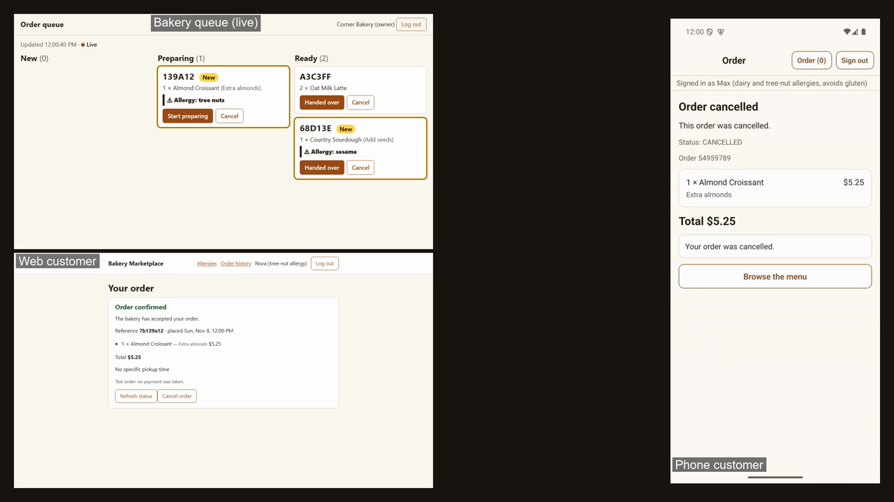

# Bakery/Coffee Marketplace — Portfolio Project

A pickup-based marketplace connecting customers with local bakeries and coffee shops and with independent or homemade vendors, built to show architecture, product and engineering ownership on a single project: from decisions and domain model to running, tested code. It is also a worked example of AI-assisted delivery: architecture decision records, contract-tested infrastructure code, load, security and test evidence, and the planning and delivery records, all kept in step with the code and under the lead's review.

[](docs/operations/demo/demo-film.mp4)

**[Watch the film](docs/operations/demo/demo-film.mp4)** (104 seconds): a web customer with a tree-nut allergy, a phone customer with dairy and tree-nut allergies and the bakery's live order queue, with other customers ordering at the same time. A local demo, test payments. [How it was made](docs/operations/demo-film.md).

## What this demonstrates

| Capability | What you will find | Start here |
|---|---|---|
| **Architecture and decisions** | Architecture decision records, amended by dated notes and never rewritten; C4 diagrams, a domain model and event storming; the patterns used (adapters with contract tests, the outbox, idempotent checkout, reserve and release, a cache with invalidation, push with polling) with what each is tested against and what happens when a dependency fails | [ADRs](docs/architecture/adr/README.md) · [how they changed](docs/architecture/decision-timeline.md) · [patterns](docs/architecture/patterns.md) · [container diagram](docs/architecture/c4/container.md) · [one request through it](docs/architecture/request-path.md) |
| **Testing** | A layered strategy; contract tests; seeded chaos scenarios that inject faults at the interfaces; a browser flake baseline (620 runs, 0 failures); mutation checks; 62 real-stack journeys; fifteen mobile flows on an emulator; cross-browser runs; test counts and line coverage from one command | [Testing: design, execution and coverage](docs/testing.md) |
| **AI collaboration** | A way of working with controls (approval gates, a clean agent, mutation checks, results reported as passed, failed, skipped or not run); the errors the assistant made and which control caught each; what 24 sessions cost; the lessons learned | [AI collaboration](docs/method/ai-collaboration.md) · [lessons](docs/method/lessons.md) · [usage records](docs/evidence/README.md) |
| **Performance, scalability and NFRs** | Targets traced to decisions and to free-tier ceilings; a 66-minute soak of the live vendor queue (762 orders, none missed, a service restart recovered); latency before and after the listing cache; resilience under failure | [Performance, scalability and NFRs](docs/performance-and-nfrs.md) · [NFRs](docs/architecture/nfrs.md) |
| **Security** | A threat model; zero-trust validation in every service; server-side browser sessions; rate limits; generated-input tests; an OWASP ZAP scan with no high finding; dependency audit and SBOMs; a review statement | [threat model](docs/architecture/threat-model.md) · [review statement](docs/governance/review-statement.md) · [security policy](SECURITY.md) · [evidence](docs/evidence/WI-SEC-005/load-soak-2026-11-03.md) |
| **Delivery and project management** | A roadmap and OKRs; Specifications with generated status and traceability; definitions of ready and done; trunk-based themed branches; a risk register; a register of findings, each with a status | [Delivery and project management](docs/delivery.md) · [roadmap](docs/product/roadmap.md) · [current plan](docs/product/backlog/current-plan.md) |
| **Product thinking** | A vision, personas and jobs to be done, a scope with what exists today, dietary safety as a first-class principle with allergens carried from the listing to the vendor's order card | [vision](docs/product/vision.md) · [scope](docs/product/scope.md) · [OKRs](docs/product/okrs.md) |
| **Frontend and mobile** | Next.js with a GraphQL BFF and Relay; a live vendor queue over server-sent events; an Expo Android app with PKCE sign-in; accessibility scans | [web customer](apps/web-customer/README.md) · [queue display](apps/web-queue-display/README.md) · [Android app](apps/mobile-customer/README.md) |

The full map of the documents is [docs/index.md](docs/index.md).

## Run it

The whole system runs on a developer machine. Nothing is deployed, and the payment is a stub: no money moves.

### System requirements

- **Docker** (running), the **.NET 10 SDK**, **Node 24 or later** (developed on 25.9), **git**, and a bash-like shell (Git Bash on Windows). Windows 11 is the platform it is developed and tested on; the pipeline runs on Ubuntu.
- **For the browser tests:** `npx playwright install chromium` once.
- **For the Android app:** JDK 17, the Android SDK, an emulator image named `bakery_pixel`, and Maestro (only for the flows). The first build takes about ten minutes ([app README](apps/mobile-customer/README.md)).
- **Memory:** the full stack with a browser or an emulator is heavy. Close other applications and run one heavy job at a time.
- **Once:** `npm ci` in each Node project you run (`apps/web-customer`, `apps/web-queue-display`, `services/graphql-bff`, `packages/web-session`, `packages/customer-core`, and `apps/mobile-customer` for the phone).

### To run the local website and the vendor's queue, with seeded data

```
node scripts/dev/demo.mjs
```

It creates the local secrets, starts Redis, the Cosmos emulator and the mock identity issuer in Docker, seeds the catalog, customers and vendors, starts the catalog, ordering and BFF services, builds and starts the customer app (port 3000) and the vendor's live queue (port 3100), prints a guide and waits. Log in as a seeded customer (for example "Alice Customer") on the first and as "Corner Bakery (owner)" on the second, place an order and watch it move. Enter or Ctrl+C tears it all down. Details and a checklist: [demo](docs/operations/demo.md); the same steps by hand: [local development](docs/operations/local-dev.md).

### To run the local mobile app and the vendor's queue, with seeded data

```
node scripts/dev/mobile-demo.mjs
```

It boots the emulator, starts the same stack, builds and installs the Android app and opens the vendor's queue beside it. Sign in as a seeded customer with allergens (for example Max) and place an order on the phone; accept it on the queue screen. `--no-build` reuses an installed app.

### To run the tests

```
dotnet test tools/BakeryMarketplace.slnx               # the shared libraries (contract tests)
dotnet test services/ordering-service/tests/OrderingService.Tests   # and the catalog and notification services
npm test                                               # in services/graphql-bff, packages/*, apps/mobile-customer
npm run test:unit                                      # in apps/web-queue-display
node scripts/ci/skeleton-smoke.mjs                     # the real stack plus the browser journeys
node scripts/dev/mobile-flows.mjs                      # the fifteen Android flows on the emulator
node scripts/ci/test-report.mjs                        # every suite once: counts, skips and line coverage
node scripts/ci/node-gates.mjs                         # the gates to run before every push
```

Some Redis and Cosmos tests skip unless `REDIS_CONNECTION_STRING` and `COSMOS_CONNECTION_STRING` are set and the containers are up; the test report says which mode it ran in. What each layer proves is in [Testing](docs/testing.md).

### Everything else

Every script and command is indexed in [scripts](docs/operations/scripts.md): the Docker profiles, the film scripts, the latency, load and security runs, the documentation generators.

## What is in the repository

```
docs/            product, architecture (ADRs, C4, DDD, contracts), process, operations, governance
                 (the open-items register), management, evidence, method, history
services/        catalog-service, ordering-service, notification-service (built, run locally);
                 admin-service (a scaffold); graphql-bff (Node/TypeScript, the single API entry point
                 for the web apps and the Android app)
apps/            web-customer and web-queue-display (Next.js), mobile-customer (Expo, Android);
                 web-admin (empty)
packages/        customer-core (cart, checkout and allergen logic shared by web and Android),
                 web-session (server-side browser sessions)
tools/           shared C# libraries with their tests: Auth (JWT, ownership, a mock OIDC issuer), Caching,
                 Data, Eventing, EventSchemas, Logging, Secrets, Seed
infra/           Terraform (a foundation stack and a dev-environment stack, validated locally, never
                 applied), OpenTelemetry collector configuration, local service environments
scripts/         dev, ci and docs scripts: the demos, the film, the real-stack smoke, the gates and the
                 generators for status, traceability and test reports
docker-compose.yml   local infrastructure: Redis Streams, the Cosmos emulator, the mock issuer, optional
                     tracing and application containers
azure-pipelines.yml  the build and test pipeline (ten jobs); azure-pipelines-dev.yml is the
                     dev-environment pipeline
```

## How the work is organised

Work is specified in **work items** (`docs/product/backlog/`), each with a status on line 1 from which [STATUS.md](docs/product/backlog/STATUS.md) is generated; **decisions** are ADRs that are amended with dated notes and never rewritten; anything found and not fixed goes into the **[open-items register](docs/governance/open-items-register.md)** in the same change; and every run leaves an **evidence record** with its commit, its command and what it does not show ([evidence](docs/evidence/README.md)). The vocabulary, templates and lifecycles are in [docs/method](docs/method/README.md), and the working agreements, risks and plans are in [Delivery and project management](docs/delivery.md).

Much of the code and documentation was written with an AI coding assistant under the lead's direction and review; [`CLAUDE.md`](CLAUDE.md) holds the rules it works to, and [AI collaboration](docs/method/ai-collaboration.md) records how that has gone, including what went wrong.

The code and documents are released under the MIT licence ([`LICENSE`](LICENSE)). A documentation site configuration exists (`mkdocs.yml`, MkDocs Material); the site is not published.
