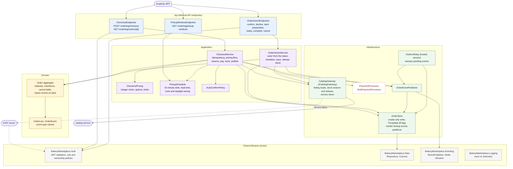
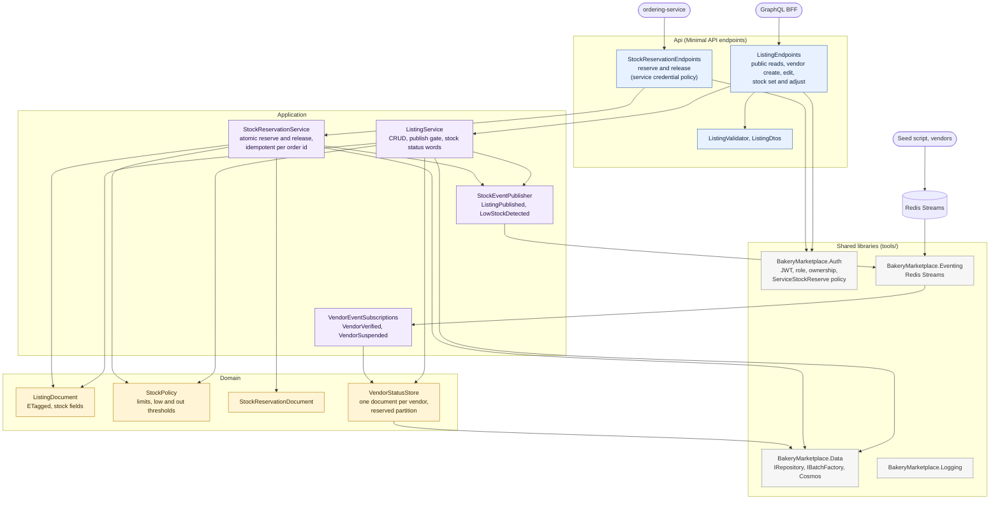

# Component diagrams: ordering-service and catalog-service

> **Status:** Current · written 2026-10-30 from the source folders `services/ordering-service/src` and `services/catalog-service/src`. Components are the main classes and folders, not every file. Both services run locally only. Containers around them are in [the container diagram](container.md).

The other two services (`admin-service`, `notification-service`) contain only `Program.cs`, so there is nothing to draw.

## ordering-service

**Reading it**
- **The aggregate raises events as data and never publishes.** The application layer stores them with the order in one write; `OrderEventPublisher` then publishes inline and `OutboxRelay` retries anything missed. Later transitions go through `OrderStore.TryUpdateAsync` and then `PublishPendingAsync`, never directly to the transport.
- **Authorization is not in the aggregate.** The endpoints and the action service decide who may call what from the token (role and ownership); the aggregate only knows the actor of a cancellation.
- **Dashed red:** the payment processor is a named stub that approves everything and logs a warning each time.
- `ICatalogGateway` is the seam to the catalog; ordering never reads the catalog's data store.

## catalog-service

**Reading it**
- **One Cosmos container, `catalog`, partitioned by `vendorId`,** holds listings, the per-vendor status documents (a reserved partition) and the reservation records, so one transactional batch can cover a listing and its reservation (ADR-0017). That sharing is why register item 66 exists.
- **The publish gate:** a listing reaches `Published` only if its vendor's tracked status is `Verified`; that status is set only from `VendorVerified` and `VendorSuspended` events, never from a client flag. Today only the seed script publishes them.
- **Public reads probe one partition per verified vendor** (register 28).
- **Missing:** no cache-aside (`WI-CAT-003`) and no outbox: events are published after the save, and a failed publish is logged and not re-sent (register 30).
