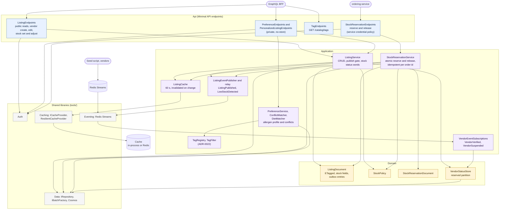
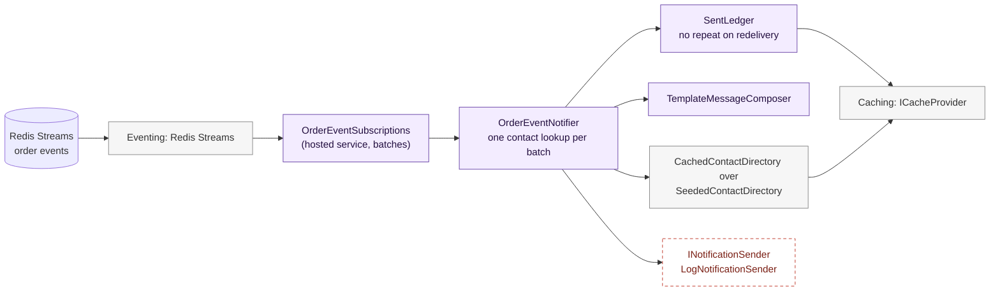

# Component diagrams: ordering, catalog and notification services

> **Status:** Current · rewritten 2026-11-08 from the source folders `services/ordering-service/src`, `services/catalog-service/src` and `services/notification-service/src` (the first version, of 2026-10-30, drew two services; the listing cache, the catalog outbox, tags and preferences, the vendor queue, the stream, the pickup fulfillment consumer and the notification service came after it). Components are the main classes and folders, not every file. All three services run locally only. Containers around them are in [the container diagram](container.md).

`admin-service` contains only `Program.cs`, so there is nothing to draw. The [GraphQL BFF](../../../services/graphql-bff/README.md) is a Node service and is shown here only as a caller.

## ordering-service

```mermaid
flowchart TB
    classDef api fill:#e8f1ff,stroke:#2b5fa8,color:#10243f
    classDef app fill:#f3ecff,stroke:#6b46a8,color:#241040
    classDef domain fill:#fff4d6,stroke:#b07d00,color:#3a2a00
    classDef infra fill:#eef7ee,stroke:#3f7f3f,color:#13301a
    classDef shared fill:#f6f6f6,stroke:#888,color:#333
    classDef stub fill:#fff,stroke:#c0392b,stroke-dasharray: 5 4,color:#7a1f14

    BFF(["GraphQL BFF"])
    CAT(["catalog-service"])
    ISS(["OIDC issuer"])
    BUS[("Redis Streams<br/>order events")]

    subgraph API["Api (Minimal API endpoints)"]
        CE["CheckoutEndpoints<br/>POST /ordering/checkout<br/>GET orders, payment-methods"]
        PW["PickupWindowEndpoints"]
        OA["OrderActionEndpoints<br/>confirm, decline, start-preparation,<br/>ready, complete, cancel"]
        VE["VendorOrderEndpoints<br/>list and read the vendor's orders"]
        VS["VendorOrderStreamEndpoint<br/>server-sent events"]
    end

    subgraph APP["Application"]
        CS["CheckoutService<br/>idempotency, pricing flow,<br/>reserve, pay, store, publish"]
        PR["CheckoutPricing, PickupSchedule,<br/>AutoConfirmPolicy"]
        PTV["PaymentTokenValidator<br/>ordering's own token rule"]
        OAS["OrderActionService<br/>actor from the token,<br/>transition, save, release stock"]
        FCH["FulfillmentCompletionHandler<br/>completes the order on the strategy's event"]
        ORS["OrphanReservationSweeper<br/>releases stock for orders that never saved"]
        LNC["ListingNameCache<br/>names for the vendor view"]
    end

    subgraph DOM["Domain"]
        ORD["Order aggregate<br/>statuses, transitions, cancel table,<br/>raises events as data"]
    end

    subgraph INF["Infrastructure"]
        GW["CatalogGateway (ICatalogGateway)<br/>reads, stock reserve and release,<br/>service token"]
        PAY["IPaymentProcessor<br/>StubPaymentProcessor"]
        ST["OrderStore, PaymentMethodStore<br/>ETag updates"]
        PUB["OrderEventPublisher"]
        RLY["OutboxRelay (hosted service)"]
        PRJ["VendorOrderProjection and<br/>VendorOrderSubscriptions<br/>(the vendor read model)"]
        HUB["VendorOrderStreamHub<br/>one channel per vendor"]
        PF["PickupFulfillment<br/>a consumer of order events"]
    end

    subgraph SH["Shared libraries (tools/)"]
        AUTH["Auth: JWT, role and<br/>ownership policies"]
        DATA["Data: IRepository, Cosmos"]
        EVT["Eventing: Redis Streams"]
        LOG["Logging: trace id, telemetry"]
    end

    BFF --> CE
    BFF --> PW
    BFF --> OA
    BFF --> VE
    BFF --> VS
    ISS -.-> AUTH
    CE --> AUTH
    OA --> AUTH
    VE --> AUTH
    VS --> AUTH
    CE --> CS
    OA --> OAS
    CS --> PR
    CS --> PTV
    CS --> GW
    CS --> PAY
    CS --> ORD
    CS --> ST
    CS --> PUB
    OAS --> ORD
    OAS --> ST
    OAS --> GW
    OAS --> PUB
    VE --> PRJ
    VE --> LNC
    LNC --> GW
    ORS --> GW
    VS --> HUB
    PRJ --> HUB
    GW --> CAT
    GW -.->|"service token"| ISS
    ST --> DATA
    PUB --> ST
    PUB --> EVT
    RLY --> PUB
    EVT --> BUS
    BUS --> PRJ
    BUS --> PF
    PF -->|"PickupWindowScheduled,<br/>OrderFulfillmentCompleted"| EVT
    BUS --> FCH
    FCH --> ST
    FCH --> PUB

    class CE,PW,OA,VE,VS api
    class CS,PR,PTV,OAS,FCH,ORS,LNC app
    class ORD domain
    class GW,ST,PUB,RLY,PRJ,HUB,PF infra
    class AUTH,DATA,EVT,LOG shared
    class PAY stub
```

**Reading it**
- **The aggregate raises events as data and never publishes.** The application layer stores them with the order in one write; `OrderEventPublisher` then publishes inline and `OutboxRelay` retries anything missed. Later transitions go through `OrderStore.TryUpdateAsync` and then `PublishPendingAsync`, never directly to the transport.
- **Ordering consumes its own events through the same interface any other service would** (ADR-0009): the vendor read model (`VendorOrderProjection`) is built from the events, safe to repeat and to run out of order (register 112), and it feeds the live stream (ADR-0021).
- **Pickup fulfillment is its own consumer** (`WI-ORD-003`, ADR-0001): the ordering core holds no reference to it. It learns of a confirmed pickup order from the event and answers with events; `FulfillmentCompletionHandler` then completes the order. A delivery strategy could stand beside it.
- **Authorization is not in the aggregate.** The endpoints and the action service decide who may call what from the token (role and ownership); the aggregate only knows the actor of a cancellation.
- **Dashed red:** the payment processor is a named stub that approves everything it is given and logs a warning each time; checkout refuses a malformed token with `PaymentTokenValidator` before the processor is called.
- `ICatalogGateway` is the seam to the catalog; ordering never reads the catalog's data store.

## catalog-service

**Reading it**
- **One Cosmos container, `catalog`, partitioned by `vendorId`,** holds listings, the per-vendor status documents (a reserved partition) and the reservation records, so one transactional batch can cover a listing and its reservation (ADR-0017). That sharing is why register item 66 exists.
- **The publish gate:** a listing reaches `Published` only if its vendor's tracked status is `Verified`; that status is set only from `VendorVerified` and `VendorSuspended` events, never from a client flag. Today only the seed script publishes them.
- **Public reads probe one partition per verified vendor** (register 28, tracking). The public listing reads go through `ListingCache` (`WI-CAT-003`; in-process by default, the cache Redis with `Cache__Backend=redis`); an edit, or a stock change that moves a listing between status words (in stock, low, out), invalidates the vendor's entries; a smaller quantity change leaves the cached quantity to drift until the 60 seconds pass. Personalized reads are never cached.
- **Events leave through an outbox.** `ListingPublished` and `LowStockDetected` are stored in the listing document in the same write as the change; the publisher sends them inline and the relay re-sends anything missed (register 30 records the progress).
- **Personalization stays in the catalog** (ADR-0022, `WI-PREF-001`, `WI-SRCH-001`): the customer's allergen profile is read in process and never leaves it; the conflicts are computed from tag ids, and "no conflicts" is an empty list, never "safe".

## notification-service

**Reading it**
- **It has no endpoints.** It consumes the order events in batches, looks up contacts once per batch, composes a message and hands it to a sender (`NOT-001`, `NOT-002`).
- **Dashed red:** no real provider (email, SMS, push) is built. The sender only logs that a message would have gone out. Contact details come from seed data and are never logged or put on an event.
- **Delivery is at least once.** The ledger stops a redelivered event from sending twice; with the in-process cache a restart can repeat a message, and a crash between the send and the mark can as well.
