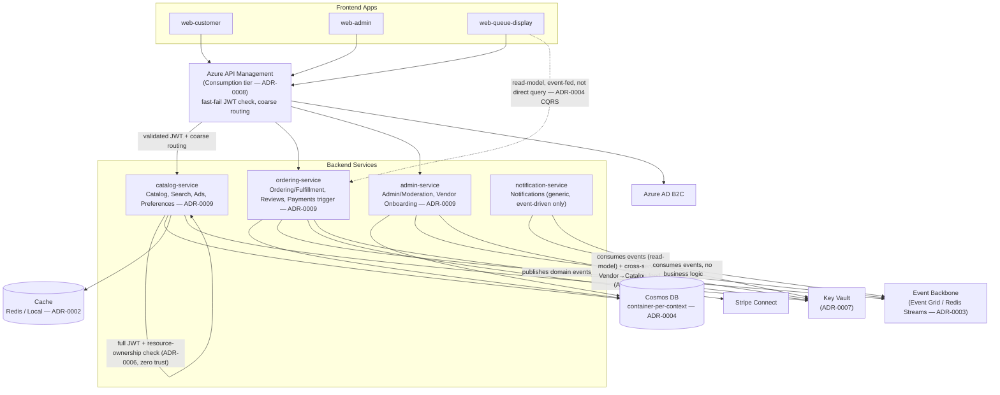

# Container Diagram

> **Confirmed**: the bounded-context-to-service mapping below is decided in **ADR-0009**, not just a diagram proposal. All 🔶 markers from the earlier draft are now resolved.

**Mapping** (per ADR-0009, minimizing service count, consistent with the MVP-small philosophy):
- `catalog-service`: Catalog & Customization + Search & Discovery + Advertising/Promotions + Preferences & Dietary Safety
- `ordering-service`: Ordering & Fulfillment + Reviews/Trust + Payments/Payouts integration (checkout trigger + payout reconciliation only — processing itself stays external per ADR-0005)
- `admin-service`: Admin/Moderation + Vendor Onboarding & Verification
- `notification-service`: Notifications only (unchanged — generic, event-driven only)

**Notes**
- `web-queue-display → ordering-service` is drawn as event-fed (dashed), per ADR-0004's explicit decision that vendor-side order views don't query the `orders` container directly.
- Every service independently validates auth per ADR-0006/ADR-0008's zero-trust posture — the gateway's check is a fast-fail optimization, not a replacement, which is why `catalog-service` shows a self-loop for its own authoritative check rather than trusting the gateway's.
- Within `catalog-service`, `ordering-service`, and `admin-service`, the co-located contexts communicate through the same interfaces/events they'd use if physically separate — the modular monolith rule from ADR-0009, not a diagram simplification. This diagram shows service-level boxes, not the internal module boundaries within each — that's a candidate for a future component-level diagram, out of scope for `WI-ARCH-001`.
