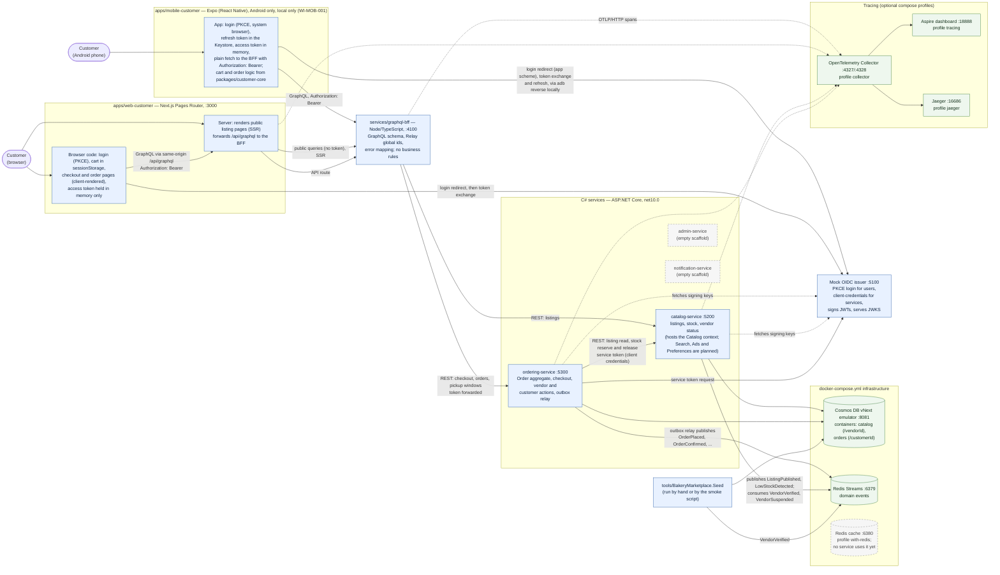
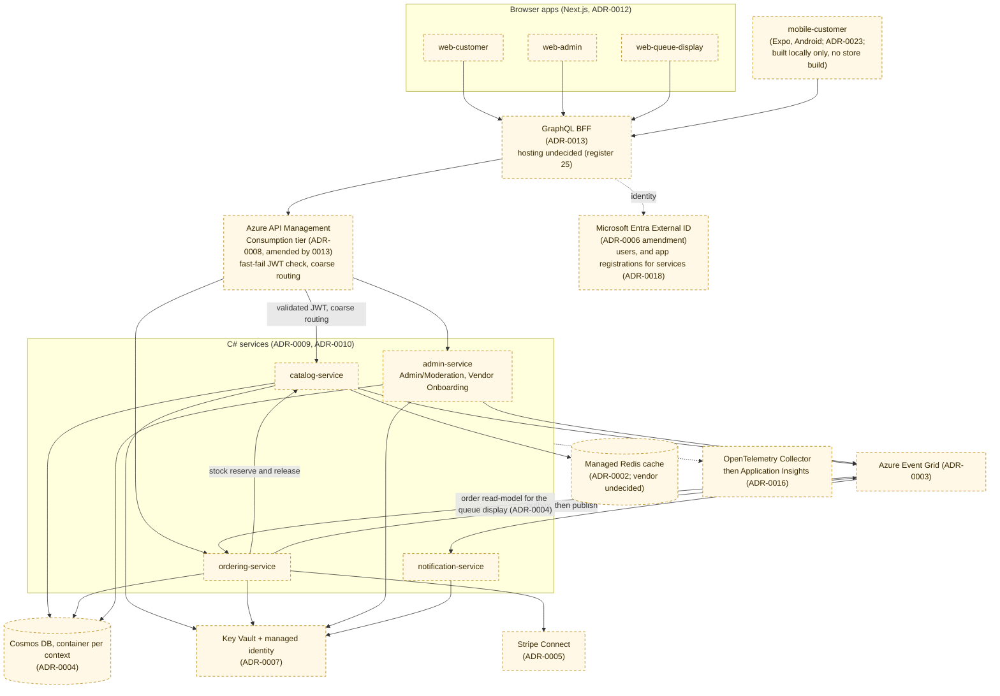

# Container Diagram

> **Status:** Current · rewritten 2026-10-30 from the code, `docker-compose.yml`, `first-slice-contract.md` and `docs/evidence/slice-1/findings.md`. The first diagram is what runs today, on a developer machine. The second is the target shape from the ADRs, none of it deployed.

The bounded-context-to-service mapping is decided in ADR-0009 (13 contexts onto 4 services, with the modular-monolith rule). The request through these containers, step by step, is in [the request path](../request-path.md).

## 1. What exists and runs locally (slice 1)

Legend: solid boxes are built and exercised by the real-stack journeys (`node scripts/ci/skeleton-smoke.mjs`). Dashed boxes are empty scaffolds or not used yet. Ports are the local defaults.

**Reading it**
- **Every service validates the token itself** (zero trust, ADR-0006): the BFF forwards the customer's bearer token unchanged, and `ordering-service` and `catalog-service` each check signature, issuer, audience and role, then ownership. There is no gateway yet, so nothing sits between the BFF and the services.
- **Service callers use their own token.** `ordering-service` calls the catalog's stock endpoints with a client-credentials token whose app role is `Stock.Reserve` (ADR-0018, local phase only).
- **Events leave ordering through an outbox**: they are stored in the same write as the order and published inline, with a relay sweeping any that missed (`WI-ORD-005`). **Nothing consumes the order events yet**, so the queue read-model (`QUE-001`) and notifications have nothing wired.
- **The catalog publishes and consumes events too.** It listens for `VendorVerified` and `VendorSuspended`, which only the seed script publishes today because no admin or onboarding service exists.
- **Tracing is optional.** Services export OTLP only when an endpoint is configured; the three tracing containers are compose profiles. The browser itself is not traced, so a trace begins at the web server or the BFF.
- **Dashed grey boxes:** `admin-service` and `notification-service` contain only `Program.cs`; the cache Redis runs under a profile but no service reads it (the catalog cache-aside, `WI-CAT-003`, is not built).
- **Not drawn because they do not exist:** `web-admin`, `web-queue-display`, API Management, Key Vault, Stripe, any cloud environment.

## 2. Target shape (decided in ADRs, not built, nothing deployed)

This is the shape the ADRs describe for a deployed environment. It differs from the first diagram where noted.

**Differences from what runs today**
- A real identity provider (Entra External ID) replaces the mock issuer; services get app registrations for service-to-service calls, with the DEV credential type still open (ADR-0018, register 62).
- API Management sits between the BFF and the services; locally the BFF calls the services directly. Every service still validates the token itself.
- Event Grid replaces Redis Streams; Redis Streams stays the local transport (ADR-0003).
- A managed Redis cache is actually used by the catalog (cache-aside, `WI-CAT-003`) and the three cache layers of ADR-0014 are owned.
- Key Vault, Stripe, `web-admin`, `web-queue-display`, and a consumer for the order events (the queue read-model and notifications) all arrive.
- Where the Next.js server and the BFF run is undecided (register item 25).

## Within a service

Co-located contexts (for example Catalog and Preferences inside `catalog-service`) still talk through the same interfaces and events they would use if they were separate services (ADR-0009's modular-monolith rule). These diagrams show service-level boxes only; a component diagram for `ordering-service` and `catalog-service` is planned (the architecture pass).
