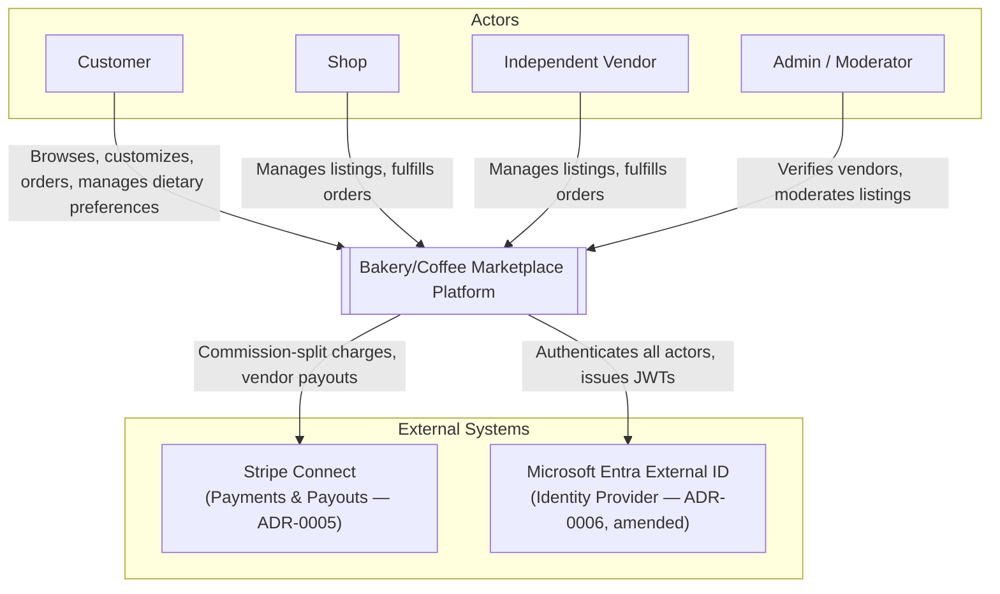

# System Context Diagram

> **Status:** Current · updated 2026-10-30. The diagram shows the intended system boundary. The notes below say what exists today.

Actors interact with the platform as a single system boundary; the platform integrates with two external systems for identity and payments.

**Notes**
- **What exists today (2026-11-08):** the customer path (web and Android) and the vendor's live order queue run, locally. Identity is a mock OIDC issuer that stands in for Entra (a real tenant is not configured), and payments are a named stub (Stripe is not integrated). Vendors act on orders in the queue screen and manage listings and stock only through the services' REST endpoints and the seed (no listing-management screen exists), and there is no admin or moderator tooling (`admin-service` is an empty scaffold). See [the container diagram](container.md) for what runs.
- Actors match the glossary (`docs/architecture/ddd/glossary.md`) exactly — no invented actors.
- A Courier actor is deliberately absent — delivery/dispatch is a designed-for, not-built, v2 extension (ADR-0001).
- The email/SMS transport underlying Notification dispatch is intentionally not shown as an external system here — it was never decided which provider (if any) handles this, so showing one would be an invented dependency. See `docs/product/backlog/PARKING-LOT.md`.
