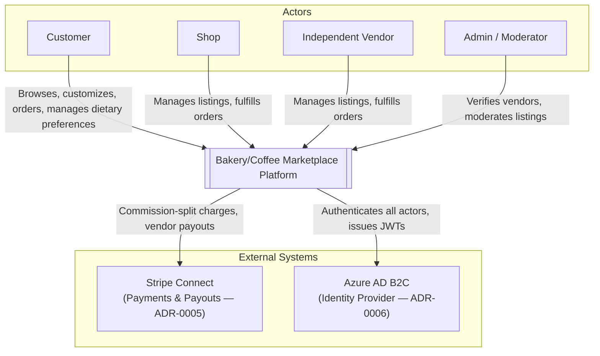

# System Context Diagram

Actors interact with the platform as a single system boundary; the platform integrates with two external systems for identity and payments.

**Notes**
- Actors match the glossary (`docs/architecture/ddd/glossary.md`) exactly — no invented actors.
- A Courier actor is deliberately absent — delivery/dispatch is a designed-for, not-built, v2 extension (ADR-0001).
- The email/SMS transport underlying Notification dispatch is intentionally not shown as an external system here — it was never decided which provider (if any) handles this, so showing one would be an invented dependency. See `docs/product/backlog/PARKING-LOT.md`.
