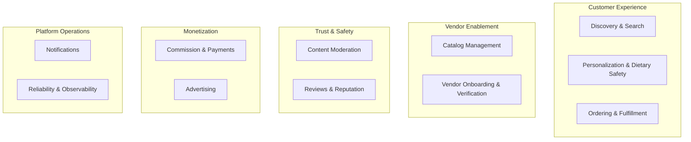

# Capability Map / Business Architecture View

> **Status:** Current · the business view drafted 2026-09-07 (`WI-ARCH-002`), read again 2026-11-08. It says what the business does, not what is built: for that see the [tech stack](tech-stack.md) and the [component page](c4/component-services.md).

Business-facing companion to `docs/architecture/ddd/bounded-contexts.md` — same underlying system, organized by what the business *does* rather than by code boundary. This document re-groups existing decisions for a different audience (particularly the Executive Sponsor role in `docs/management/stakeholder-communications-plan.md`); it doesn't reclassify or redecide anything.

## Customer Experience

| Capability | Bounded context(s) | Hosted in | Classification | Serves |
|---|---|---|---|---|
| Discovery & Search | Search & Discovery | `catalog-service` (ADR-0009) | Core | Dana (Customer) |
| Personalization & Dietary Safety | Preferences & Dietary Safety | `catalog-service` (ADR-0009) | Core | Dana (Customer) |
| Ordering & Fulfillment | Ordering & Fulfillment | `ordering-service` (ADR-0009) | Core | Dana (Customer), Marcus (Shop) |

## Vendor Enablement

| Capability | Bounded context(s) | Hosted in | Classification | Serves |
|---|---|---|---|---|
| Catalog Management | Catalog & Customization | `catalog-service` | Core | Marcus (Shop), Priya (Independent Vendor) |
| Vendor Onboarding & Verification | Vendor Onboarding & Verification | `admin-service` (ADR-0009) | Supporting | Priya (Independent Vendor), Sam (Admin) |

## Trust & Safety

| Capability | Bounded context(s) | Hosted in | Classification | Serves |
|---|---|---|---|---|
| Content Moderation | Admin/Moderation | `admin-service` | Supporting | Sam (Admin) |
| Reviews & Reputation | Reviews/Trust | `ordering-service` (ADR-0009) | Supporting | Dana (Customer), Marcus/Priya (Vendors) |

## Monetization

| Capability | Bounded context(s) | Hosted in | Classification | Serves |
|---|---|---|---|---|
| Commission & Payments | Payments & Payouts | `ordering-service` (ADR-0009) — processing itself external via Stripe, ADR-0005 | Generic (buy, not build) | Marcus/Priya (Vendors), platform revenue |
| Advertising | Advertising/Promotions | `catalog-service` (ADR-0009) | Supporting | platform revenue |

## Platform Operations

| Capability | Bounded context(s) | Hosted in | Classification | Serves |
|---|---|---|---|---|
| Notifications | Notifications | `notification-service` | Generic | all personas |
| Reliability & Observability | Caching, Eventing, Data Store, Auth, Secrets, API Gateway (cross-cutting) | all services | Generic (foundational) | all personas, indirectly |

## Priority, reusing the existing MVP-line legend

No new priority scale — this map uses exactly the legend from `docs/product/scope.md`: every capability above listed as "Core" or feeding a Core context is MVP; "Supporting"/"Generic" capabilities are mostly MVP-lite (per each capability's underlying epic status in `epic-catalog.md`) except where explicitly Deferred (full ad-bidding under Advertising, delivery/dispatch under Ordering & Fulfillment).

## Related

- `docs/architecture/ddd/bounded-contexts.md` — the classification and integration patterns this map reuses
- ADR-0009 — the service hosting this map's "Hosted in" column reflects
- `docs/product/personas.md` — the personas this map's "Serves" column names
