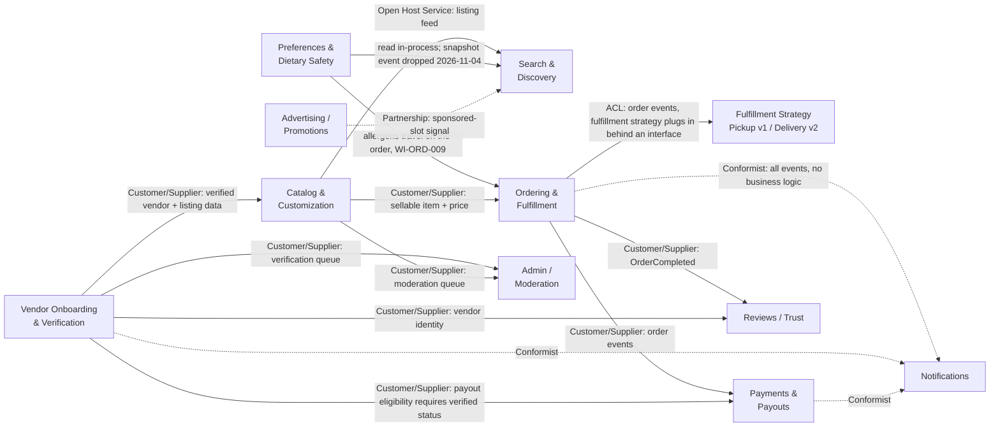

# Bounded Context Map

> **Status:** Current · checked 2026-10-30, built state updated 2026-11-08. This is the domain design. Implemented, locally: **Catalog** and **Ordering** (in `catalog-service` and `ordering-service`); **Preferences** (the allergen profile, inside `catalog-service`, ADR-0022); **Search** only as the personalized read of listings with conflicts (`catalog-service`, `WI-SRCH-001`); the **Pickup Fulfillment** strategy (a consumer of order events inside `ordering-service`, `WI-ORD-003`); and **Notifications** (`notification-service`, with no real provider). Vendor Onboarding, Admin and Moderation, Payments (a stub), Reviews and Advertising are design only. See `docs/architecture/c4/container.md` and `component-services.md`.

## Strategic classification

**Core domains** (differentiators — invest design effort here first)
- **Catalog & Customization** — listings, modifiers/add-ins, allergy flags on items
- **Preferences & Dietary Safety** — the customer preference/allergy profile and where it's enforced
- **Ordering & Fulfillment** — cart, checkout, pickup scheduling, order lifecycle, and the fulfillment-strategy extension point (pickup now, delivery later)
- **Search & Discovery** — ranking that blends dietary-safe filtering with sponsored placement

**Supporting subdomains** (necessary, not differentiating — build simply)
- **Vendor Onboarding & Verification**
- **Advertising/Promotions**
- **Reviews/Trust**
- **Admin/Moderation**

**Generic subdomains** (solved problems — consider buy-over-build)
- **Notifications** — pure event-triggered dispatch, no business logic of its own
- **Payments & Payouts** — commission calc + vendor payouts; strong candidate for a third-party processor (e.g., Stripe Connect) rather than building from scratch — worth its own ADR

## Context map

## Integration patterns used (and why)

| Pattern | Where | Rationale |
|---|---|---|
| **Open Host Service / Published Language** | Catalog → Search, Preferences → Search & Ordering | Multiple downstream consumers need a stable, well-defined feed rather than a point-to-point contract each |
| **Customer/Supplier** | Vendor → Catalog, Vendor → Payments, Ordering → Payments/Reviews | Clear upstream/downstream — the supplier's model changes propagate deliberately, not silently |
| **Anticorruption Layer** | Ordering → Fulfillment Strategy | This is *the* seam where pickup-only v1 must not leak assumptions that would break when delivery/dispatch is added in v2 — documented in its own ADR |
| **Conformist** | Everything → Notifications | Notifications has no domain opinions of its own; it just renders templates off whatever events arrive |
| **Partnership** | Advertising ↔ Search | Both must evolve together for the sponsored-ranking blend to make sense — neither is strictly upstream |

## Explicit scope note

A **B2B small-supplier context** (shops sourcing raw ingredients from local suppliers) was considered during modeling and scoped out of v1 — see `glossary.md`. It would sit as its own upstream context to Vendor Onboarding if built later, not folded into it.
