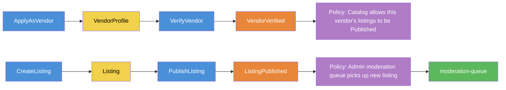
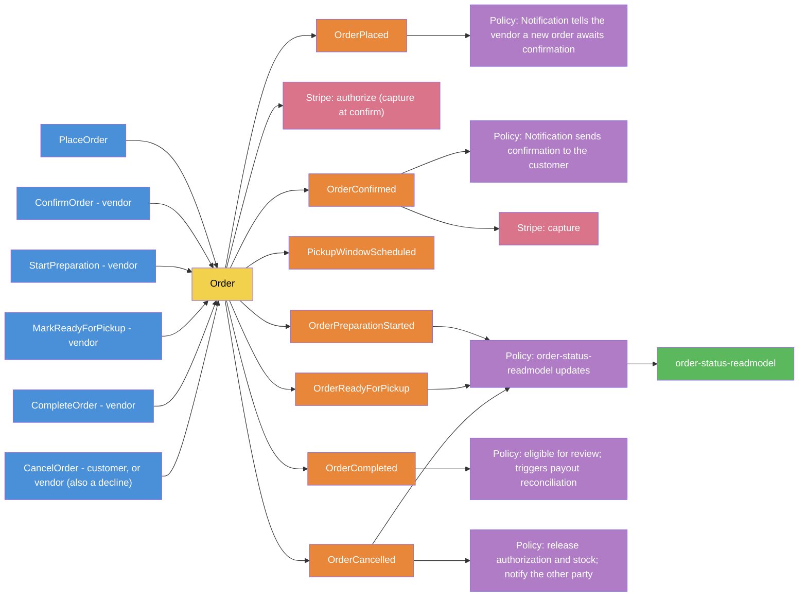
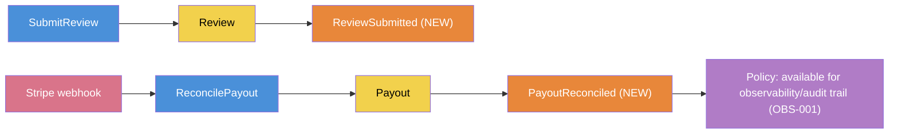
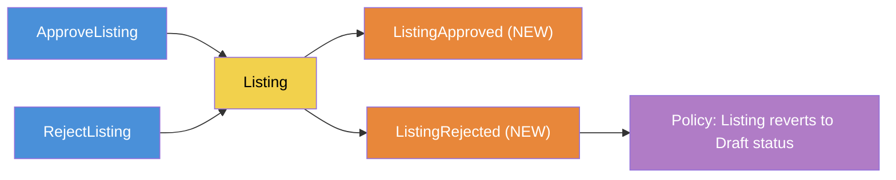

# Event Storming Session Output

Walks the main business processes end-to-end: Command → Aggregate → Domain Event → Policy/Reaction → Read Model, in process order. This exercise surfaced four events that existed as real business moments but had never been named anywhere — `ReviewSubmitted`, `PayoutReconciled`, `ListingApproved`, `ListingRejected` — added to `docs/architecture/ddd/glossary.md` and to the relevant services' event lists in `docs/architecture/data-model-api-contracts.md` as part of this exercise, not left living only in this document.

## Legend

🔵 Command · 🟨 Aggregate · 🟧 Domain Event · 🟪 Policy/Reaction · 🟩 Read Model · 🟥 External System

## Flow 1 — Vendor Onboarding & Listing Publication

## Flow 2 — Order Lifecycle

> **Updated 2026-10-28** (`docs/architecture/order-lifecycle.md`): the flow now starts with the customer building a Pending order, adds the vendor's confirmation step, cancellation (including a vendor decline and a response timeout) and authorize-then-capture payment. `OrderCustomized` / `CustomizeOrder` are removed from the flow: customization happens while the order is Pending. Payment timing is a direction, not yet an ADR amendment (open item 53).

## Flow 3 — Review & Payout *(this exercise named 2 new events here)*

## Flow 4 — Listing Moderation *(this exercise named 2 new events here)*

## What this exercise found

Consistent with `project-process-framework/core/context-completeness.md`'s framing — this isn't a gap to be embarrassed about, it's exactly what the exercise is for. Four real business moments (a review being submitted, a payout actually reconciling, a moderation decision going either way) existed operationally but had no named event anywhere before this document was written. Both `glossary.md` and `data-model-api-contracts.md` were corrected as part of this same item, not left for a future cleanup pass.

## Related

- `docs/architecture/ddd/glossary.md` — updated with the 4 new events
- `docs/architecture/data-model-api-contracts.md` — `ordering-service` and `admin-service` event lists updated to match
- ADR-0003 — the delivery semantics (at-least-once, per-aggregate sequencing) these new events follow, same as every other event
