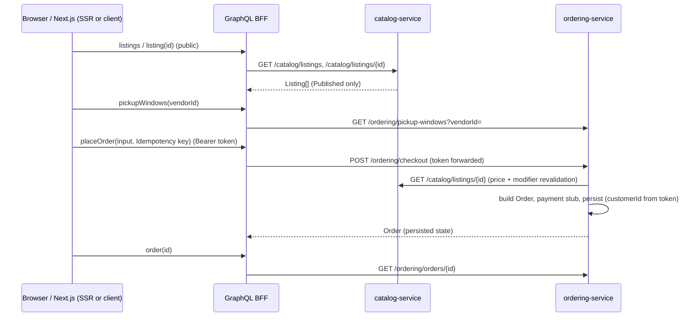

# First-Slice Contract: Browse → Customize → Pickup → Test Checkout → Order Status

**Status:** Accepted as the slice-scope record (`WI-PORT-007`, drafted 2026-10-26; all decisions D-1 to D-10 accepted; §4 and §5 moved 2026-10-28). D-1 to D-4 accepted 2026-10-26; D-5 to D-10 accepted as written 2026-10-28 (human lead). Nothing below is implemented unless a work item's evidence says so (`CAT-001` listing reads and the seed are). Where the existing docs are silent or inconsistent, this file raises an **open decision (D-n)** with a recommended default rather than inventing a policy.

**Authority:** C# services own price, listing state, pickup availability, order state and persistence (ADR-0013). The GraphQL schema (now in `data-model-api-contracts.md`, "First-slice mapping") is a composition contract over the REST endpoints in `data-model-api-contracts.md`. Field names follow `docs/architecture/ddd/glossary.md`.

**Sources reused:** `data-model-api-contracts.md` (`Listing`, `Order`, endpoints), `WI-CAT-001`, `WI-ORD-001`/`002`/`003`/`004`/`006`, `WI-DEV-004`, `FulfillmentContracts.cs` (`OrderStatus`, `FulfillmentDetails`), ADR-0001/0003/0004/0009/0013/0014/0016.

---

## 1. Scope and what is real vs stubbed

| Step | Real | Stubbed / simplified |
|---|---|---|
| Browse + detail | `catalog-service` reads `Published` listings from the Cosmos `catalog` container | Seeded data only; no vendor UI (`DEV-004`) |
| Customization | Modifier selection validated by `catalog-service` data, priced server-side | Allergy *personalization* (`SRCH-001`, `CUST-006`) is **out of the first slice**; plain `allergenFlags` are shown |
| Pickup window | `ordering-service` validates the chosen window | Window list is deterministic and generated (see D-3) |
| Checkout | Order built from server-side prices and persisted | Payment is `IPaymentProcessor` stub that always succeeds, named and logged as a stub (`WI-ORD-001`); no Stripe |
| Confirmation/status | Read from persisted `orders` | Status is `Placed` only in this slice; later transitions exist in the domain but have no UI |

Explicitly out: reviews, payouts, vendor-side queue UI, preferences, search ranking, sponsored placement, delivery.

## 2. Request path

Parallelism: a listing detail page may fetch `listing` and `pickupWindows` concurrently. `placeOrder` is a single downstream call; the BFF does not compose multi-step writes. `traceparent` is forwarded on every downstream call (ADR-0016). The caller's bearer token is forwarded unchanged; services re-validate it (ADR-0006).

## 3. Domain/API contract table

| Operation | Owning service | REST | GraphQL | Validation owner | Failure cases | Tests |
|---|---|---|---|---|---|---|
| List listings | catalog | `GET /catalog/listings` (Published only; anonymous, see D-4) | `Query.listings(first, after)` | catalog | empty result; downstream timeout | contract + SSR smoke |
| Listing detail | catalog | `GET /catalog/listings/{id}` | `Query.listing(id)` / `node(id)` | catalog | not found; not Published | contract |
| Pickup windows | ordering | **new** `GET /ordering/pickup-windows?vendorId=` (D-3) | `Query.pickupWindows(vendorId)` | ordering | none available; unknown vendor | contract + clock-injected unit |
| Place order | ordering | `POST /ordering/checkout` (cart endpoint deferred, D-2) | `Mutation.placeOrder(input)` | **ordering** (never the BFF) | see §6 | contract + invariants |
| Order status | ordering | `GET /ordering/orders/{id}` (Customer, own) | `Query.order(id)` / `node(id)` | ordering | not found; not owner | contract + authz |

## 4. REST shapes used by the slice

**Moved 2026-10-28** to `data-model-api-contracts.md`, section "First-slice mapping" (REST shapes), as `WI-PORT-006` pass 2 planned. Money follows D-1: integer cents, USD (`priceCents`, `priceDeltaCents`).

## 5. GraphQL schema draft (minimum for the walking skeleton and first checkout)

**Moved 2026-10-28** to `data-model-api-contracts.md`, section "First-slice mapping" (GraphQL schema draft). The implemented subset is `services/graphql-bff/schema/schema.graphql`.

## 6. Error and state behavior

| Situation | Service response | GraphQL result | UI behavior |
|---|---|---|---|
| Loading | n/a | Relay suspense | skeleton |
| No listings | 200, `[]` | empty connection | empty state |
| Listing not found / not Published | 404 | `listing: null` | not-found page |
| Order not found, or not the caller's | 404 (never 403, to avoid leaking existence) | `order: null` | not-found |
| Listing unpublished/changed since page load | 409/422 `listing_unavailable` | `PlaceOrderRejected{LISTING_UNAVAILABLE}` | message + refetch listing |
| Modifier not on listing | 422 `invalid_modifier` | `INVALID_MODIFIER` | message |
| Quantity < 1 or above limit (D-5) | 422 | `INVALID_QUANTITY` | field error |
| Window unavailable/expired/past | 409 `pickup_window_unavailable` | `PICKUP_WINDOW_UNAVAILABLE` | choose another; refetch windows |
| Stub payment rejects (test hook) | 402 | `PAYMENT_DECLINED` | message |
| Duplicate submit, same key + same request | 200/201 with the **original** order | `PlaceOrderSuccess` (same `order.id`) | shows confirmation once |
| Same key, different request body | 422 `idempotency_key_reuse` | `VALIDATION_FAILED` | message |
| Downstream timeout/5xx | 5xx | top-level `INTERNAL` + reference ID | retry guidance |
| Missing/invalid token on `placeOrder`/`order` | 401 | `UNAUTHENTICATED` error | login |

**Idempotency (proposed, D-6):** key supplied by the client per checkout attempt (UUID generated when the checkout form opens). Scope: `(customerId, key)`. Because `orders` is partitioned by `customerId` (ADR-0004), a Cosmos unique-key constraint on the key within the partition is a candidate enforcement mechanism; confirm in `WI-ORD-006`. The BFF never retries `placeOrder` automatically.

## 7. Seed data contract (reuse `WI-DEV-004`; no second seed source)

Deterministic IDs so tests, SSR smoke and Playwright can assert exact values. Extends `DEV-004`'s 2 vendors / 5–10 listings; the slice needs only the subset below.

| Vendor | id | Type | Status |
|---|---|---|---|
| Corner Bakery (fixture name) | `vendor-shop-001` | Shop | `Verified` (via published `VendorVerified`) |
| Homemade Treats (fixture name) | `vendor-indep-001` | Independent | `Verified` |

| Listing | id | Base (cents) | Modifiers (priceDeltaCents, allergens) | allergenFlags |
|---|---|---|---|---|
| Country Sourdough | `listing-sourdough-001` | 800 | `mod-seeds` +100 (sesame); `mod-sliced` +0 | gluten |
| Almond Croissant | `listing-croissant-001` | 450 | `mod-extra-almond` +75 (tree-nut) | gluten, dairy, tree-nut |
| Oat Milk Latte | `listing-latte-001` | 500 | `mod-extra-shot` +75; `mod-vanilla` +50 | (none) |
| Draft listing (negative case) | `listing-draft-001` | 300 | | status `Draft`, must **not** appear in browse |

Expected totals for tests (cents): 2× sourdough + `mod-seeds` = **1800**; croissant + `mod-extra-almond` ×1 = **525**; latte + both modifiers ×3 = **1875**. Idempotent: re-running the seed changes nothing. Pickup windows come from the clock-injected generator (D-3), so tests pin the clock instead of seeding windows.

## 8. Contract tests (specified; implemented by `WI-PORT-002`/`CAT-001`/`ORD-001`)

1. **Price not trusted:** a checkout request carrying forged `price`/`total`/`customerId`/`status` fields ignores them; response totals equal §7 expectations.
2. **BFF↔service agreement:** for each §3 operation, the BFF's mapped GraphQL response equals the REST body field-for-field (golden fixtures from the seed).
3. **Authoritative state:** `order(id)` reflects the persisted document, not the mutation's echo; a second read returns identical data.
4. **Publish gate:** `Draft` listings and listings of a non-`Verified` vendor never appear in `listings` and are rejected at checkout.
5. **Invariants:** totals are non-negative; quantity ≥ 1; order status is one of the existing `OrderStatus` values and starts at `Placed`.
6. **Idempotency:** same key + body twice → one persisted order; same key + different body → rejected.
7. **Authorization isolation:** customer A cannot read customer B's order; `order(id)` for an unowned ID is indistinguishable from not found.
8. **Error mapping:** every §6 row produces the stated GraphQL shape and exposes no stack trace, internal URL or raw downstream body.
9. **Cache safety (ADR-0014):** public listing responses carry an explicit `Cache-Control`; `order`/`placeOrder` responses are `private, no-store`; two SSR requests with different fixtures never share data.

## 9. Trace and correlation requirements (ADR-0016)

- Next.js server starts a new trace per request; BFF and services continue it via `traceparent`/`tracestate`.
- Span attributes use low-cardinality names: `service`, `operation` (e.g. `placeOrder`), `status`, `error.category`. Never record tokens, `Authorization`, full GraphQL variables, `idempotencyKey` values, or customer-identifying fields.
- The `extensions.reference` returned to clients equals the trace ID, so a user-reported reference finds the trace.
- The event backbone is **not** on the first-slice synchronous path. `OrderPlaced` is published by `WI-ORD-005` and carries `traceparent` (consumers link, not parent); the slice does not depend on it.

## 10. Gaps found in the existing documents (record, don't assume)

1. **No pickup-window availability endpoint exists** anywhere. `WI-ORD-003` schedules a window but nothing lists choosable windows → D-3.
2. **Cart persistence is unspecified.** `POST /ordering/cart` exists, but ADR-0002 forbids caching cart data and no cart container is defined → D-2.
3. **Listing reads' auth requirement is unstated.** ADR-0012 renders listing pages with SSR for anonymous visitors, so `GET /catalog/listings*` must allow anonymous access for `Published` data → D-4.
4. **Money type was unspecified** (`price` had no declared type or currency in the model). ADR-0005 / open item #7 settle USD, single currency; D-1 (accepted) settles integer cents and no tax.
5. **`WI-DEV-004` seeds `VendorVerified` via the event backbone**, so the catalog publish gate depends on Redis Streams being up. The seed and the compose file (`DEV-002`) must therefore ship together.
6. **Public reads are not single-partition (found by `WI-CAT-001`).** `catalog` is partitioned by `vendorId`; browse and lookup-by-id have no vendor. The service reads or probes one partition per verified vendor. Fine for the slice; to scale, embed the vendor in the listing id, add a cross-partition query to `IRepository<T>` (shared-contract change), or add a browse read model.
7. **No seed script exists yet.** `catalog-service` defaults to in-memory storage with no data. `WI-DEV-002` (Compose, Cosmos emulator, Redis) is now done and verified, so `WI-DEV-004` can be built; recommended as the single seed source for the first end-to-end run rather than an interim in-memory seed (which would be a second seed source). Constraints are noted in `WI-DEV-004`.

## 11. Decision log

| # | Decision | Recommended default | Owner | Blocks |
|---|---|---|---|---|
| D-1 | Money representation, tax/fees, rounding | **ACCEPTED 2026-10-26.** USD (settled by ADR-0005). Amounts are **integer minor units (cents)** over REST; GraphQL `Money` is `{ cents: Int!, currency }` with currency `USD`; never binary floats. No tax/fees/discounts in the slice. Round half-up to the cent at line level. | Human lead (decided) | `CAT-001` DTOs, `PORT-002` schema |
| D-2 | Cart | **ACCEPTED 2026-10-26.** Slice skips `POST /ordering/cart`; the cart lives in browser (Relay/UI) state and `checkout` takes line items. The endpoint stays in the contract as deferred. | Human lead (decided) | `ORD-001`, `CUST-003` |
| D-3 | Pickup-window source | **DECIDED 2026-10-26 (simple):** add `GET /ordering/pickup-windows?vendorId=` returning deterministic, clock-injected 15-minute slots within a single configured set of hours. **Deferred:** per-vendor hours, per-slot capacity, stock tied to a window, and rules for late or early pickup. Owned by `ordering-service`/`PickupFulfillment`. | Human lead (decided) | `ORD-003`, `CUST-003` |
| D-4 | Anonymous reads | **ACCEPTED 2026-10-26.** `GET /catalog/listings*` allows anonymous callers for `Published` listings only; everything else requires a token (`CAT-001` acceptance amended by reconciliation note). | Human lead (decided) | `CAT-001`, `PORT-002`, SSR |
| D-5 | Quantity limits | **ACCEPTED 2026-10-28, as written.** 1–20 per line, at most 10 lines per order (placeholder bounds, validated in `ordering-service`). | Human lead (decided) | `ORD-001` |
| D-6 | Idempotency scope and retention | **ACCEPTED 2026-10-28, as written.** `(customerId, key)`; retained for the order's life (key stored on the order), no separate TTL store. | Human lead (decided) | `ORD-001`, `ORD-006` |
| D-7 | Time zone | **ACCEPTED 2026-10-28, as written.** Store and transmit UTC (ISO 8601 `Z`); display in the vendor's local zone, taken from vendor config. The seed vendors use one fixed zone. | Human lead (decided) | `ORD-003`, UI |
| D-8 | Pickup-window expiry rule | **ACCEPTED 2026-10-28, as written.** A window is selectable only if its `start` is at least a configured lead time (default 30 min) after the clock; checked again at checkout. | Human lead (decided) | `ORD-003` |
| D-9 | GraphQL ID scheme | **ACCEPTED 2026-10-28, as written.** Relay global IDs = base64 of `Type:serviceId`, produced and decoded only in the BFF. | Human lead (decided) | `PORT-002` schema |
| D-10 | Stub-payment test hook | **ACCEPTED 2026-10-28, as written.** A reserved test listing or header triggers `PAYMENT_DECLINED` in non-production only, so the rejected path is testable. | Human lead (decided) | `ORD-001`, e2e |

### Implementation check, 2026-10-28 (D-5 to D-10 against the code at `main` be2d85c plus this branch)

| # | Result | Evidence |
|---|---|---|
| D-5 quantity limits | Not implemented, no mismatch (`ordering-service` is an empty scaffold) | `services/ordering-service` has `Program.cs` only |
| D-6 idempotency | Not implemented, no mismatch. The seed is idempotent, which is a different thing | `Seeder.cs` |
| D-7 time zone | **Gap:** no vendor time-zone field exists in the vendor model, seed or catalog DTOs. Instants are `DateTimeOffset` in event payloads, which is compatible with UTC. | grep for zone/timezone finds nothing |
| D-8 window lead time | Not implemented, no mismatch (no pickup-window endpoint yet) | `PickupWindowScheduledPayload` carries `DateTimeOffset` start/end only |
| D-9 GraphQL IDs | **Fixed 2026-10-28** (`feature/slice-followups`; the BFF now issues and strictly decodes base64 `Listing:<id>` global IDs; `vendorId`, `Modifier.id` and cursors stay raw, open item 41). Was: **Mismatch:** the BFF returns raw catalog ids as GraphQL `ID`s (`id: l.id`), and `node(id)` takes a raw listing id. No base64 `Type:serviceId` encoding or decoding exists. The resolver comment says this is deliberate for the slice ("ids are catalog listing ids"). | `services/graphql-bff/src/resolvers.ts:15,44-46` |
| D-10 payment hook | Not implemented, no mismatch (no payment stub yet) | none |
| D-1 spillover (not asked) | Catalog REST and GraphQL use integer cents and USD. **Inconsistency:** `PayoutReconciledPayload.NetAmount` is `decimal` (still open). *Update 2026-10-28:* the data-model doc now carries `priceCents` / `priceDeltaCents` notes and a payout-money row in its "First-slice mapping" section. | `DomainEventPayloads.cs`; `data-model-api-contracts.md` lines 22-23, 66, 92 |

Follow-ups, not yet scheduled: (a) D-9 needs a code change in the BFF (global ID encode/decode, `Type:serviceId`) before a second node type or any stored/linked ID depends on raw ids; it is a BFF-only change but touches the Relay schema and the web-customer routes. (b) A vendor time-zone field must be added when `ORD-003` lands. (c) `PayoutReconciledPayload` money type and the data-model doc's price names should be reconciled with D-1 (the rename is already announced in contract §4).

## 12. Next steps

1. ~~Human lead approves or amends §3–§11~~ **Done**: D-1 to D-4 2026-10-26, D-5 to D-10 2026-10-28.
2. ~~Amend `WI-CAT-001`, `WI-ORD-001`, `WI-ORD-003` with dated reconciliation notes.~~ **Done 2026-10-26.**
3. ~~Move §4 and §5 into `data-model-api-contracts.md` as a "First-slice mapping" section~~ **Done 2026-10-28** (the `WI-PORT-006` pass-2 row for that file); this file stays as the slice-scope record.
4. ~~Start `WI-CAT-001` against §4, and `WI-PORT-001` in parallel.~~ **Done** (`CAT-001`, `PORT-001`, and the `PORT-002` skeleton).
