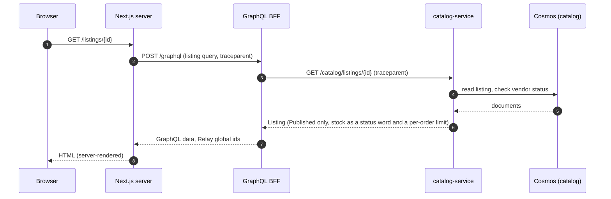
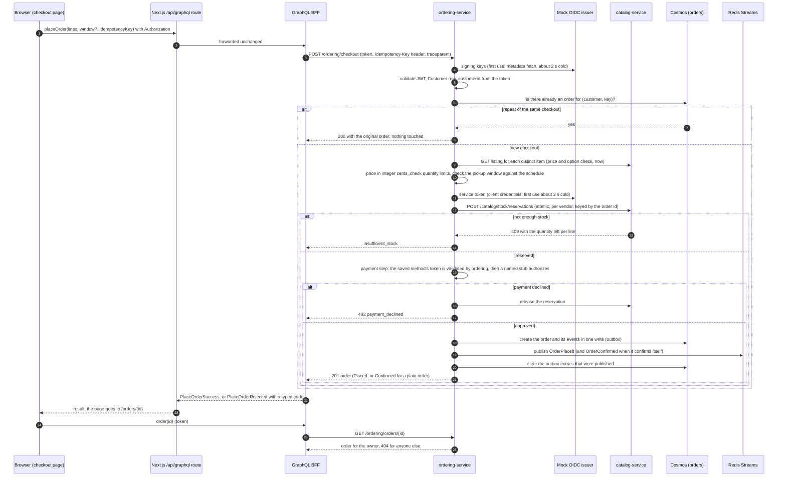

# Request path

> **Status:** Current · written 2026-10-30 from `first-slice-contract.md`, the ordering and catalog code and outcome notes, and the captured trace in `docs/evidence/slice-1/findings.md`. Describes the local stack; nothing is deployed. The containers are in [the container diagram](c4/container.md).

Three paths cover slice 1: logging in, loading a public page, and placing and reading an order. Timings come from the one capture on a developer machine; they are measurements, not budgets.

## 1. Logging in (Authorization Code with PKCE)

The browser logs in on its own, and the access token lives in browser memory only (ADR-0006; a reload logs the user out, register item 24).

```mermaid
sequenceDiagram
    autonumber
    participant B as Browser
    participant W as Web app server (/api/auth/*)
    participant O as Mock OIDC issuer
    participant R as Redis (session store)
    B->>W: GET /api/auth/login?returnTo=/path
    W->>R: pending login (state, PKCE verifier), 10 minutes
    W-->>B: 302 to the issuer (challenge, state, registered redirect_uri) + short-lived cookie with the pending id
    B->>O: GET /authorize
    O-->>B: login page (mock users), then 302 to /api/auth/callback?code&state
    B->>W: GET /api/auth/callback?code&state (pending cookie)
    W->>R: take the pending login (once)
    W->>O: POST /token (code, verifier, no secret)
    O-->>W: access token (signed JWT, roles in `roles`) and a refresh token
    W->>R: session = tokens, encrypted (AES-256-GCM)
    W-->>B: 302 to returnTo + HttpOnly session cookie (an opaque id)
    Note over B,W: the page holds no token; GraphQL calls carry the cookie,<br/>and the server adds Authorization: Bearer for the BFF
```

## 2. Loading a public page (no token)



One trace covers the web server, the BFF and the catalog. The page-render span does not exist, and the browser hop is untraced (register 42, 82).

## 3. Placing an order and reading it back

`placeOrder` is a single downstream call: the BFF does not compose multi-step writes. All rules (price, stock, pickup window, idempotency) live in `ordering-service`.



**What the order does next.** A plain order (no option on any line, no requested window) confirms itself in the same write that places it (`WI-ORD-008`); an order with an option or a requested window stays `Placed` until the bakery acts through the vendor endpoints (`WI-ORD-007`). A failed publish does not fail the checkout: the order is stored with its events, and `OutboxRelay` sweeps and sends any that were missed. Nothing reads the published events yet.

## What travels on each hop

| Hop | Token | `traceparent` | Idempotency key | Notes |
|---|---|---|---|---|
| Browser to Next.js `/api/graphql` | customer bearer | not sent (browser untraced) | in the `placeOrder` input | same origin, so no CORS for GraphQL |
| Next.js server to BFF (SSR) | none (public pages) | new trace | no | |
| BFF to services | customer bearer, forwarded unchanged | forwarded | sent as the `Idempotency-Key` header | services re-validate the token |
| `ordering-service` to `catalog-service` | the service's own client-credentials token | continued | no (the order id keys the reservation) | app role `Stock.Reserve` |
| Services to Cosmos and Redis | none | spans only | n/a | Cosmos calls show as client spans |

## What was measured

In the captured run (`docs/evidence/slice-1/findings.md`) one checkout was one trace across the BFF, ordering and catalog, and nine checkouts took 4675 ms (the first, on a cold stack) and then 55 to 78 ms. About 2 s of the first was fetching the issuer's metadata and about 2 s was fetching ordering's service token, both from a cold mock issuer; the BFF's checkout timeout is 15 s and ordering's own call timeout is 5 s. No token, key or secret appeared in any exported span. On 2026-10-30 the real-stack journeys that walk this path passed in each of 3 runs (`docs/evidence/baseline-2026-10-30.md`).
