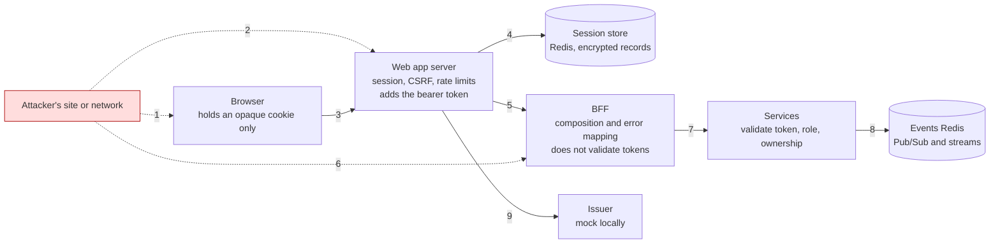

# Threat model: the browser, session and stream surface

> **Status:** Current · written 2026-11-02 by the AI agent that wrote most of the code under review (`WI-SEC-005`, register item 129). It is a first model, not an independent one: it lists what the agent could see from the code, the tests and the documents. The services behind the BFF are covered only at their edge. Nothing here has been checked against a deployed system, because none exists. The section on the Android app was added 2026-11-04 (`WI-MOB-001`), with the same limits.

## Scope and method

**In scope:** the vendor's queue display and the customer app (browser), their Next.js servers' API routes (`/api/auth/*`, `/api/graphql`, `/api/graphql-stream`), the shared session package, the session store, the GraphQL BFF, and the edge of ordering-service and catalog-service (token validation, ownership, the vendor stream and the vendor actions). **Out of scope:** payment (a stub), the admin and notification services (scaffolds), deployed infrastructure, Entra, and the mock issuer's own security (it is a test tool). Method: for each trust boundary, what an attacker can send or hold, what stops it, what test shows it, and what is left. Threats are grouped by the STRIDE headings only to make gaps easier to see.

## Assets

1. **A login**: the session id in the cookie, and the tokens held for it on the server (access token, refresh token).
2. **A vendor's orders and what can be done to them** (the queue, and now accept, decline, start, ready, hand over): a vendor's customers, items and pickup times.
3. **A customer's orders and their dietary choices** (treated as quasi-health data, NFR 3.7).
4. **Availability of the vendor's screen** during service hours.
5. **The secrets**: the session encryption key, the services' client secret (`.env`, never committed).

## Trust boundaries

1 and 2 are the internet; 3 is the only route the browser is meant to use; 6 is anyone who can reach the BFF's port directly (locally, anyone on the machine; in the cloud, behind API Management, ADR-0008, not built); 8 is the weakest link on the ground: Redis requires no authentication locally and Pub/Sub carries order documents in the clear (register item 127).

## Threats, controls, evidence, and what is left

"Evidence" names tests that exist and pass (local runs only). **Gap** marks a threat with no control or no test; each gap is in the register.

### Spoofing (who is calling)

| # | Threat | Control | Evidence | Left |
|---|---|---|---|---|
| S1 | Guessing or stealing a session id | 256-bit random opaque id; `HttpOnly`; `SameSite=Lax`; `__Host-` and `Secure` except on loopback HTTP; idle and absolute lifetimes | package tests on the cookie and the id shape; both apps' browser tests that the page holds no token | Over HTTP on loopback the cookie is not `Secure` (by design, local only). Theft by script depends on S6 |
| S2 | Forged login callback or a code injected into someone's login | `state`, PKCE verifier, a one-use pending-login record, tied to a cookie | package tests; browser tests of a forged state | The real issuer has not been used |
| S3 | A token made up by the caller | Every service validates signature, issuer, audience and role itself (zero trust, ADR-0006); the BFF forwards the token unchanged | service and library tests; real-stack journeys with a junk token get 401 | Keys are the mock issuer's. Entra not tested |
| S4 | A browser sending its own `Authorization` header | The web route drops it and uses the session's | browser test "an Authorization header sent by the browser is never passed on" | none known |
| S5 | A second vendor acting on the first's order | Ordering takes the vendor from the token and answers 404 for another vendor's order | ordering tests; BFF test; real-stack journey (vendor actions) | none known |

### Tampering (changing what is sent or stored)

| # | Threat | Control | Evidence | Left |
|---|---|---|---|---|
| T1 | Cross-site request forgery on the web routes, including the vendor actions | `SameSite=Lax` plus an `Origin` equal to the app's and a JSON content type on every state-changing request and on the stream | package tests; both apps' browser tests (foreign, missing, form-encoded) | Origin-based; a browser that sends no `Origin` on a same-origin POST would be refused, not allowed |
| T2 | An altered or copied session record in the store | AES-256-GCM with the session id as associated data | package store tests | The key is a process secret; rotation needs a restart (ADR-0007) |
| T3 | Open redirect through `returnTo` | Only a path inside the app is accepted | package tests of the rules | none known |
| T4 | A repeated checkout or action taking effect twice | Idempotency key at checkout; the order's state machine refuses a repeated action (409) | service tests; real-stack journey (repeat is "not allowed now") | none known |
| T5 | Events altered or injected by whoever reaches the events Redis | Authentication on Redis in the deployed design (not built) | none | **Open: register 127.** Locally Redis has no password |
| T6 | Query injection into Cosmos | Parameterized SDK queries only (NFR 3.4) | code review; no scan | No dynamic or static scan has been run (item 129 step 4) |

### Repudiation and information disclosure

| # | Threat | Control | Evidence | Left |
|---|---|---|---|---|
| R1 | A token, cookie, idempotency key or e-mail in a log or a trace | Logs name events, not values; the collector drops URL queries | tests that the token is never logged (BFF, package); slice-1 capture (NFR 3.6) | Checked on the code paths tested, not by a scan of real logs under load |
| R2 | Error text that reveals internals | Fixed client-safe messages; the BFF maps every downstream failure to a generic error | BFF tests for 5xx and for unknown codes | none known |
| R3 | One vendor reading another's orders or stream | The stream is opened with the token's vendor, never one the caller names; the web route strips the customer id | ordering and BFF tests; the real-stack journey for a second vendor | The channel carries the customer id in the clear on the events Redis (register 127) |
| R4 | A customer's data in a vendor's view | The vendor read model does not name the customer | schema and mapping tests | none known |
| R5 | A cached private response | `private, no-store` on authenticated and API responses | browser and BFF tests of the headers | Public pages are cacheable by design |
| R6 | Who did what (an action by a vendor) is not recorded | The services log the action and the order carries the actor of a cancellation | service tests | There is no audit log of vendor actions as a feature; the events are the record |

### Denial of service

| # | Threat | Control | Evidence | Left |
|---|---|---|---|---|
| D1 | Many streams from one vendor or login | 5 per vendor, 5 per login, 500 per process and per BFF | tests at each layer | Never approached under real load (item 129 step 3) |
| D2 | A client that never reads or never finishes sending | Write timeout, silence limit, body read before a stream is counted, request timeouts | tests for each | none known |
| D3 | A flood of requests, logins or junk cookies | Per-address and per-login rate limits (`WI-RATE-001`); BFF backstop | package, BFF and browser tests | Counts are per process; numbers are starting values; not load tested |
| D4 | A large or deeply nested GraphQL operation, many aliases, a batch | Body limit 64 KB at the BFF and the web route | tests of the body limit | **Fixed 2026-11-02 (register 135):** limits on depth, root fields and total fields; introspection can be switched off (`BFF_DISABLE_INTROSPECTION=1`), on by default |
| D5 | Many screens reconnecting together after a restart | Backoff with randomness in the live feed | unit tests of the feed | Never tried at scale |
| D7 | One malformed request ending the BFF process | Validation of `variables` and `operationName`; a catch around the execution so nothing escapes the handler | process-level test that starts the BFF and sends the bodies; 1,200 generated requests | **Found and fixed 2026-11-02 (register 136):** a string for `variables` ended the process. It had no control before |
| D6 | A slow or failing service holding the BFF's requests | Bounded timeouts; a generic error | BFF tests (slow ordering) | none known |

### Elevation of privilege and the browser as a victim

| # | Threat | Control | Evidence | Left |
|---|---|---|---|---|
| E1 | A customer calling a vendor action | The service checks the role; the BFF maps 403 to FORBIDDEN | BFF test; real-stack journey | none known |
| E2 | A stream outliving a revoked role | The stream ends at the token's expiry; the web route ends it when the session ends | package and ordering tests | **Accepted by the lead:** up to the token lifetime (review round 2) |
| E3 | Clickjacking: the queue display framed in another site, tricking a vendor into pressing Accept or Decline | `frame-ancestors 'none'` and `X-Frame-Options: DENY` on every response (register 134, 2026-11-02) | browser test: a page on another origin that frames the app gets no rendering of it; shown to fail without the headers | none known |
| E4 | Script injection in the page (XSS) reading the page or sending requests as the user | React escapes by default; the page holds no token (so a script cannot steal one); a search of both apps and the session package finds no `dangerouslySetInnerHTML` | the "nothing readable in the page" browser test | `Content-Security-Policy` with `connect-src 'self'` and `script-src 'self' 'unsafe-inline'` (register 134) | browser tests: a script from another origin does not run; a request to another origin is blocked | `'unsafe-inline'` remains because of Next.js's inline scripts: an injected inline script is not stopped, and could still call the API as the logged-in vendor |
| E5 | Other missing headers (`X-Content-Type-Options`, `Referrer-Policy`, `Permissions-Policy`, HSTS in the cloud) | `X-Content-Type-Options`, `Referrer-Policy` and `Permissions-Policy` on every response; the login callback keeps `no-referrer` | header tests in both apps | HSTS is not set (HTTP locally; belongs on the HTTPS ingress) |
| E6 | A malicious dependency | `graphql-sse` was reviewed by hand and pinned exactly; lockfiles committed | the review record | No audit or SBOM yet (`WI-SEC-004`) |
| E7 | Test hooks enabled outside tests | `ENABLE_TEST_HOOKS` is inert in production by configuration | tests of the hook | Relies on the operator not setting it; no deployed check |
| E8 | A secret committed | `gitleaks` over the full history before every push | the scan record | A secret in an image or a pipeline variable is not scanned |

## The Android app (added 2026-11-04, `WI-MOB-001`, ADR-0023)

A new trust boundary: a native client on a device the customer holds, signing in without a server of its own. **New asset:** the app's refresh token (it lives on the device, in the Keystore). Everything after the token reaches the BFF is the same as the browser path (S3, S5): the services validate the token and the ownership themselves. Local only: one emulator image, the mock issuer, no real device, no release build. **Not evidence of safety:** the evidence column lists tests that exist; most of the app's own token code has no automated test yet (`WI-MOB-003`).

| # | Threat | Control | Evidence | Left |
|---|---|---|---|---|
| M1 | A lost or stolen device gives its refresh token to someone | The refresh token is stored with `expo-secure-store` (Android Keystore) and deleted on sign-out or when the issuer refuses it; the access token is kept in memory only | restart without login and sign-out then restart, both in the Maestro flows (`docs/evidence/WI-MOB-001/`) | The token works until it expires (8 h by default, renewed on use); the mock issuer cannot revoke a login on request (register 145). The Keystore protection depends on the device lock |
| M2 | Another app on the device claims the app's redirect scheme and reads the authorization code | PKCE (S256) makes a stolen code useless without the verifier, which never leaves the app; a random `state` is checked; the system browser (Custom Tabs) is used, not a web view | the issuer's PKCE tests; the login flow passes; the app's `state` and callback checks have **no unit test** | Android lets any app declare a private-use scheme. App Links (an https redirect verified against the app) are not used. A real tenant was not tried |
| M3 | The issuer is used to bounce a login to an address the attacker chose | The redirect must equal a registered address exactly; a non-http scheme is accepted only in reverse-domain form (with a dot) and never in the defaults | `MockOidcAuthorizeHardeningTests` (unregistered, prefix, case, fragment, `//` form, non-dotted schemes); the live container answered 200 for the app's scheme and 400 for another | The mock issuer only; a deployed dev issuer accepts the scheme only if configured. The lead's review of this change is pending |
| M4 | Tokens end up in logs, plain storage or the cart | Tokens are not logged or written to plain storage; the cart is in memory and cleared on sign-out | a code review by the agent; nothing asserts it | **Gap:** `WI-MOB-003` adds asserts on the fakes |
| M5 | Traffic read or changed on the network | Cleartext http exists only in the debug manifests (the emulator reaches the host through `adb reverse`); no release build was made | the manifests Expo generates (read, not tested) | A release build over https was never built or run; the mock issuer and the BFF are http locally |
| M6 | The test switch ships: a build that can ask the BFF to decline payments | The switch is compiled in only with `EXPO_PUBLIC_TEST_HOOKS=1`; the BFF forwards the header only with `ENABLE_TEST_HOOKS=1` and ordering ignores it in Production; the demo builds without it and the BFF without the hook | the demo run of 2026-11-04 (no switch on the checkout screen, see the evidence) | A person could still build the test build and install it; nothing stops that on a device |
| M7 | A refresh failing because the network is down signs the customer out, or a refusal is mistaken for an outage | Only a refusal by the issuer deletes the token; an unreachable issuer keeps it | the logic is written that way; **no test** | **Gap:** `WI-MOB-003` |
| M8 | A rooted or tampered device, a modified app | Not addressed | none | Out of scope for this build (no attestation, no root detection) |
| M9 | The name shown after sign-in is forged or carries markup or control characters ("Signed in as ...", `WI-MOB-002`) | The name is read from the token only for display: the app does not check the signature and decides nothing from it (the services validate the token, ADR-0006); it is cleaned (control characters become spaces, 80 characters) and shown as plain text; with no name nothing is shown | `identity.test.ts` in `packages/customer-core` (markup returned as text, control characters, length, malformed and unsigned tokens, no throw); the flows assert the name after login and after a restart | A forged name can only mislead the person holding the device. The check that React Native shows it as plain text is by construction, not a test |

## What the findings change

Two gaps were found by writing the table and looking for the control: **no browser hardening headers (register 134)** and **no GraphQL cost limits (register 135)**. Both were fixed the same day (see the table). What remains, in the agent's judgment, in order of risk: the unauthenticated, cleartext events Redis (known, tied to the deployed design, register 127); `'unsafe-inline'` in `script-src`; the BFF's backstop being shared by all users of a web app (see the soak record); and everything an independent reviewer would find that this agent would not.

## What this model is not

Not independent, not exhaustive, and not a penetration test. It was written by the agent that wrote the code, from the same understanding that wrote the controls, so it shares that agent's blind spots. The lead's review and an outside review are the checks that would not share them (register item 129; the statement of what has been reviewed is `docs/governance/review-statement.md`, when written).
