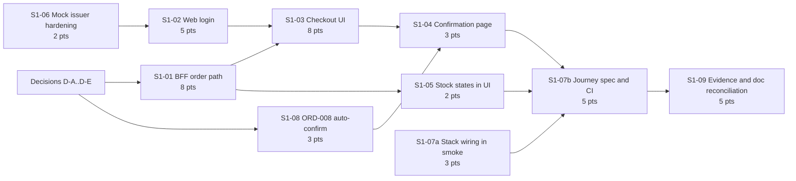

# Slice 1: plan and critical path

> **Status:** Snapshot · 2026-10-29, written at the end of slice 1 and not maintained since. For what is built and what is next read [the current plan](../../product/backlog/current-plan.md) and [STATUS.md](../../product/backlog/STATUS.md); the item numbers S1-xx and N-xx are still used by the [roadmap](../../product/roadmap.md).

**As of 2026-10-29.** See also the [status](01-project-status.md) and the [prioritized backlog](03-prioritized-backlog.md) (item IDs `S1-xx` are defined there).

**Sequencing is relative, not calendar-dated**, as in `docs/management/project-plan.md`: available hours per week are not decided, so there are no dates. Sizes are story points on a relative scale (backlog document); they order the work and show where the weight is, and are not a forecast.

## Definition of done for slice 1

Slice 1 is done when all of these are demonstrated on the local stack **and** in the Azure pipeline, with evidence linked from `docs/evidence/`:

1. A visitor browses listings and a listing detail page (server-rendered, public), and sees in-stock, low and sold-out states.
2. The visitor logs in through the mock issuer (Authorization Code with PKCE) and logs out.
3. The customer customizes an item (options, quantity), optionally picks a pickup window, and places a test order. A banner says payment is a stub.
4. An order with no customization and no pickup window **confirms automatically** (once `ORD-008` is approved); an order with either stays **Placed**. Both appear correctly on the confirmation page with no vendor action.
5. Errors in contract section 6 show sensible messages: unavailable item, insufficient stock, bad window, declined test payment, duplicate submit (same order returned), expired login.
6. One trace covers browser or SSR, BFF, ordering and catalog.
7. Playwright runs the journey in CI against the real stack.
8. Documents and the register match what was built.

## Assumptions

- Header-only, in-memory token (ADR-0006) for slice 1. The cookie-session alternative is a follow-up decision (D-C).
- The browser reaches the BFF through the existing same-origin Next.js rewrite (`/api/graphql`, `apps/web-customer/next.config.js`), so **no CORS work is needed** for browser calls. This is verified by test in `S1-01`, not assumed.
- Payment stays a stub. Vendor actions stay REST-only; the demo needs none if `ORD-008` is approved.
- The queue display, preferences and personalization, the admin console and notifications are out of slice 1.

## Work breakdown and dependencies

(`S1-01` is one package of two sequential parts, read side then `placeOrder`, because the BFF schema is a single shared file and has one owner at a time. `S1-06` is only a soft prerequisite for `S1-02`: login can be built against the mock issuer as it is, but the encoding fix should land before the demo.)

## Critical path

Longest chain of dependent work, by points:

**Decisions → `S1-01` BFF order path (8) → `S1-03` checkout UI (8) → `S1-04` confirmation page (3) → `S1-07b` journey spec and CI (5) → `S1-09` evidence (5)** = **29 points**.

Why this is the chain:

- `S1-03` needs both the BFF mutations and the login, but login (5) is shorter than the BFF package (8) and runs in parallel, so the BFF package is the binding one.
- `S1-04` needs `placeOrder`'s result shape and `order(id)` from `S1-01`, and the auto-confirm rule from `S1-08` to make the confirmed-versus-placed cases testable.
- The journey spec needs the whole UI. The stack wiring (`S1-07a`) does not, so it is done early, off the critical path, which removes the biggest CI surprise from the end.
- `S1-09` is last by nature, but its trace and run-ID parts (items 42, 44) can be prepared during the wait for CI.

Total slice 1 work is about **44 points**; the critical path is about 29. Everything else has float, but not much: `S1-02` (5) has about 3 points of float before it starts blocking `S1-03`.

## Waves

| Wave | Items | Notes |
|---|---|---|
| 0. Decisions | D-A to D-E | No code. D-A and D-B unblock wave 1. Can overlap with wave 1 start for items that do not need them. |
| 1. Parallel start | `S1-01a` (BFF read side), `S1-02` (web login), `S1-06` (mock issuer), `S1-08` (`ORD-008`), `S1-07a` (stack wiring) | Different files, so they can run on separate branches or in one branch as separate commits. The BFF schema has one owner. |
| 2. Write path | `S1-01b` (`placeOrder`, token and trace forwarding, error mapping), `S1-05` (stock states) | Needs `S1-01a`. |
| 3. Checkout UI | `S1-03` | Needs `S1-01`, `S1-02`. |
| 4. Confirmation and journey | `S1-04`, then `S1-07b` | `S1-04` needs `S1-08` if the confirmed state is to be shown. |
| 5. Close out | `S1-09` | Evidence, doc reconciliation, register updates, a recorded Azure run. |

## Working rules (from the repo conventions)

- One commit per work item, tests first, mutation checks on new rules, `node scripts/ci/linux-check.mjs` before pushing .NET work, `npm run format:check`, `lint`, `typecheck` and the e2e and skeleton suites before pushing web or BFF work.
- **Batch fixes and agree before each push**; do not push repeatedly while a PR is failing.
- Human approval is required for security and auth logic (`S1-02`, `S1-06`'s allowlist, token forwarding in `S1-01`) and before expanding scope (`S1-08`).
- Findings not fixed in the same change go to the open-items register.

## Candidate rule: auto-confirm (`ORD-008`), for approval

**Proposal (from the human lead):** when an order contains only items that are in stock, with no customization and no pickup-window request, it confirms automatically at checkout, with no vendor action. Start simple (a configuration switch), with a per-item or per-vendor flag later. This removes the "status stays Placed" gap and lets Playwright reach both Confirmed and Placed without a vendor step or a timer.

How it would work:

- Checkout builds the order, reserves stock, authorizes the payment stub, then stores the order as `Placed`. If the rule matches, the same write also moves it to `Confirmed`, so the outbox carries `OrderPlaced` then `OrderConfirmed`, in order, from one save.
- The rule lives in ordering (a business rule, not the BFF). A `Placed` order with a customization or a pickup window waits for the vendor exactly as today.
- Cancellation, stock release and every later vendor step are unchanged. A customer can still cancel a `Confirmed` order (and releases the stock).
- The aggregate has no "actor" on confirm, so a system confirmation needs no model change, but the event or the order should record that it was automatic (small addition, so a vendor can tell which orders they never saw).
- Payment: item 53's direction is authorize at place and capture at confirm. With auto-confirm that collapses to one step for these orders, which is fine for a stub and should be noted for `PAY-001`.

**Decided 2026-10-28 (D-A): option 1.** The question was: the proposal says "an item with available quantity". The public listing read exposes stock only as `inStock`, `low` or `soldOut`, and **made-to-order items always report `inStock`**, so ordering cannot tell a counted ready-made item from a made-to-order one. Options: (1) the rule ignores that distinction (no customization and no window is enough), which is simplest and needs no catalog change; (2) the catalog adds a field such as `stock.tracked` so only counted, ready-made items auto-confirm (about 2 more points, touches catalog and the contract). Recommendation: **option 1 for slice 1**, with the flag-per-item as the later refinement, because made-to-order items without options can equally be accepted automatically in a demo and the vendor control belongs in the later flag.

This is a new rule beyond the approved lifecycle, so it needs an explicit approval (D-A) and dated updates to `order-lifecycle.md`, `first-slice-contract.md` section 1 ("status is Placed only") and the register.

## Session storage and the cookie question (D-C)

ADR-0006 says header-only, no cookies, and records that any cookie-based token storage changes the CSRF analysis and needs mitigation. The pattern that fits is a **backend-for-frontend session**: the Next.js server holds the tokens (in Redis) and gives the browser only an opaque session id in an `__Host-` cookie that is `HttpOnly`, `Secure` and `SameSite=Strict`; the server adds the `Authorization` header when it calls the BFF. This keeps the token out of reach of page scripts, survives reloads (item 24), and allows server rendering of authenticated pages (item 26). It does **not** come free of cost: it needs CSRF protection (SameSite plus an Origin check and a required custom header on GraphQL POSTs), a server-side session store, rotation and logout handling, and an ADR amendment. Services keep validating the JWT themselves (zero trust, unchanged).

Planning position: **not in slice 1.** It would replace `S1-02`'s in-memory token handling, so building the simple version first means some rework (estimated 8 points for the cookie-session, versus 5 for `S1-02`), but it keeps the first slice shippable and puts an auth-model change through its own decision record. If the human lead prefers to avoid the rework, the alternative is to replace `S1-02` with the cookie-session version now (about 8 to 13 points, adding roughly 3 to 8 to the critical path).

## Beyond slice 1: recommended order

After slice 1, the next candidates in value order (details in the backlog):

1. **Cookie-session (ADR-0019)** if not done in slice 1, and **`AUTH-006` phase 2** (DEV credentials), which gate any deployed environment.
2. **Vendor read side:** vendor "my orders" and own listings (items 63 and 76), via the event-fed read model (`QUE-001`), which also unlocks the queue display (`QUE-002`) and needs item 29 (consumer-group naming) fixed first.
3. **`ORD-003` remainder** (`PickupFulfillment` events and the pickup-confirmed path that takes over `complete`).
4. **Real payment** (`PAY-001`, with items 53 and 69) and **notifications** (`NOT-001`).
5. **Deployment readiness:** container images (item 71), hosting decision (item 25), Terraform, DEV identity, real Cosmos and Redis verification.
6. **Personalization (M4):** preferences, search flags, preference UI (`PREF-*`, `SRCH-001`, `CUST-005`, `CUST-006`).
