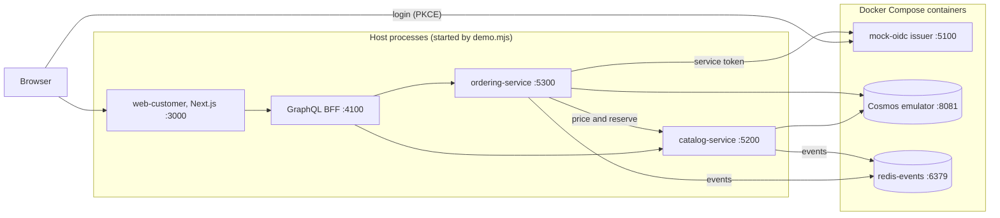

# Demo: run slice 1 and show it

> **Status:** Current · written and run 2026-10-30 on Windows 11 with Docker Desktop (`scripts/dev/demo.mjs`, 87 s from start to a stopped stack with the web build; screenshots by `scripts/dev/capture-journey.mjs`). Nothing is deployed and the payment is a test stub. A run on a machine with nothing cached, and a person following this page without help, have not been done (`WI-DEMO-001`).

What it shows: a customer browses listings with stock and allergens, chooses a quantity or an option, logs in through the local mock identity issuer, places a test order, and watches its status. Behind that: a Next.js app, a GraphQL BFF, a catalog service and an ordering service, with Cosmos, Redis Streams and the issuer in Docker. How the pieces work is in [the request path](../architecture/request-path.md); the commands for running by hand are in [local development](local-dev.md#run-slice-1).

## Start

You need Docker (running), the .NET 10 SDK, Node 24 or later and git, and `npm ci` done once in `apps/web-customer` and `services/graphql-bff`. From the repository root:

```
node scripts/dev/demo.mjs
```

It creates the local secrets (a git-ignored `.env`), starts the three Docker containers, seeds the catalog, starts the four processes, builds the web app, warms the stack and prints a guide. The first run also builds the .NET projects. Ports 3000, 4100, 5200 and 5300 must be free; the script refuses to start otherwise. Press Enter or Ctrl+C to stop; everything is torn down and the data is lost (`--keep` leaves Docker running).

## Where things run



The BFF forwards the caller's token unchanged and every service validates it itself against the issuer. `scripts/dev/demo.mjs` starts everything above; `docker compose up` alone starts only the three containers; `scripts/ci/skeleton-smoke.mjs` starts the same stack and runs the browser journeys instead of waiting.

## Checklist: show the journey

| Step | Do | Expect |
|---|---|---|
| 1. Start | `node scripts/dev/demo.mjs`, wait for the guide (about 90 s with caches warm) | `http://localhost:3000`, the mock users, the steps |
| 2. Browse | Open the URL | Six listings with price, stock and allergens: "Blueberry Oat Muffin" is sold out, "Almond Croissant" is low stock |
| 3. Choose | Open "Country Sourdough"; pick quantity 2 (or the sesame option) | The estimate updates; options show their allergens ("contains sesame") |
| 4. Add | Add to order, then open "Your order" | The cart shows the line; checkout asks you to log in |
| 5. Log in | Log in | The mock issuer's own page; choose "Login as Alice Customer (Customer)" |
| 6. Order | Choose a pickup time if you like, then "Place test order" | The first checkout takes several seconds (7.0 s measured); later ones well under a second |
| 7. Status | Read the order page | A plain order is "Order confirmed" by itself; an order with an option or a pickup time waits for the bakery. "Test order: no payment was taken." |
| 8. Stop | Enter or Ctrl+C | Processes stopped, containers removed |

What not to expect: there are no vendor, admin or queue screens (those apps are empty), no search, no real payment, and the look is one small stylesheet (light and dark by system setting), not a designed brand. Reloading an order page ends the login (register item 24), so the page asks again.

## Screenshots

Taken by `node scripts/dev/capture-journey.mjs` against the running demo (after the styling pass of 2026-10-30, register item 97).

| Browse | Listing |
|---|---|
|  |  |

| Login | Checkout |
|---|---|
|  |  |


## If something goes wrong

| Symptom | Likely cause and what to do |
|---|---|
| `port <n> (...) is already in use` | Something else is on 3000, 4100, 5200 or 5300; stop it |
| Stuck at the environment check | Docker is not running or is still pulling images; `docker compose ps` and `node scripts/dev/check-env.mjs --wait 180` |
| `<name> did not become healthy` | Read `artifacts/demo/<name>.log` (catalog, ordering, bff, web) |
| The listing page shows no listings | The seed did not run or the catalog is down; stop and start again (data is not kept) |
| The first checkout seems stuck | It takes about 7 s the first time (service token, first priced checkout); wait |

## Measured and not measured

- The script was run once from start to stop, with `--stop-after 20`: 87 s, exit 0, no containers left. The warm-up requests (issuer metadata, the home page, pickup times) all returned 200, but the first checkout still took 7.0 s afterwards: the warm-up does not cover the first priced checkout (register item 98).
- Docker images, NuGet packages and npm packages were already cached. A first run on a machine with nothing cached will take longer; it has not been timed (`WI-DEMO-001`).
- Not done: a person who did not write this following the page, and timing how long a visitor takes to find the evidence from the README (`WI-DEMO-001`, rows G-H07 and G-H09).
