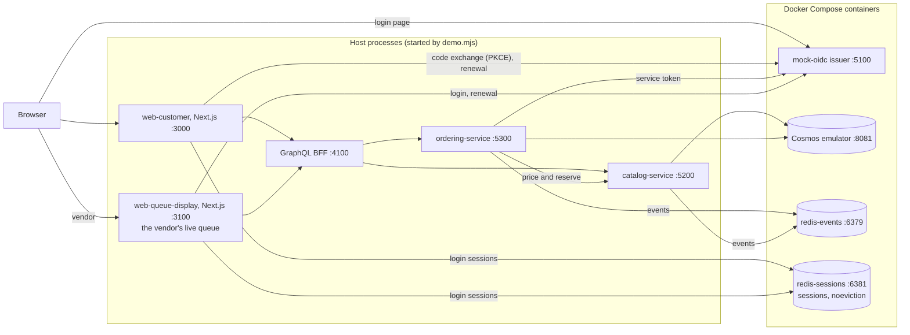
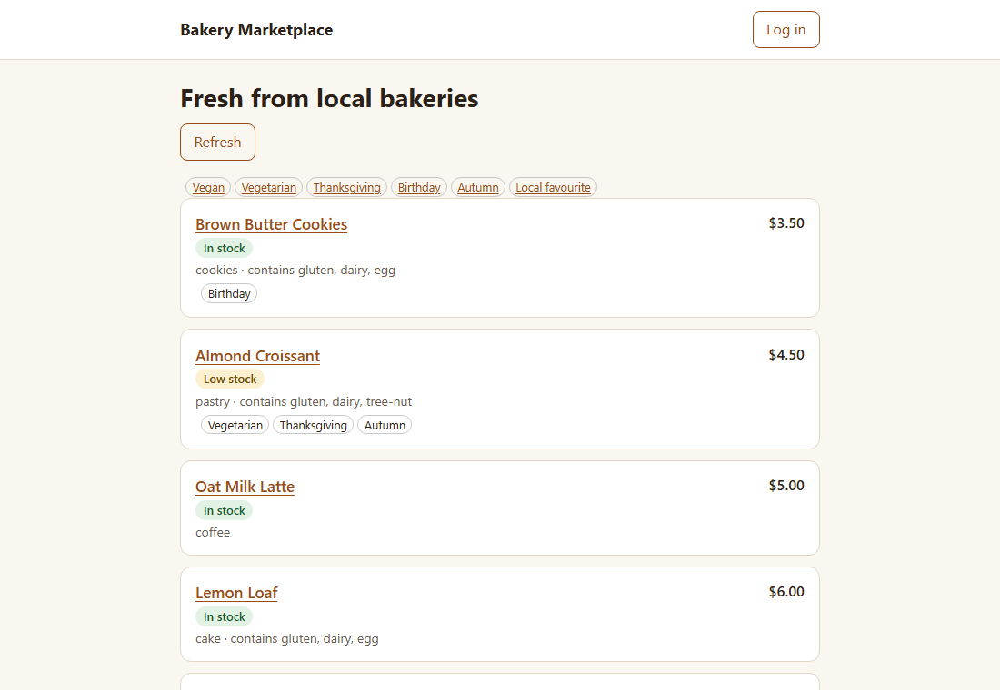
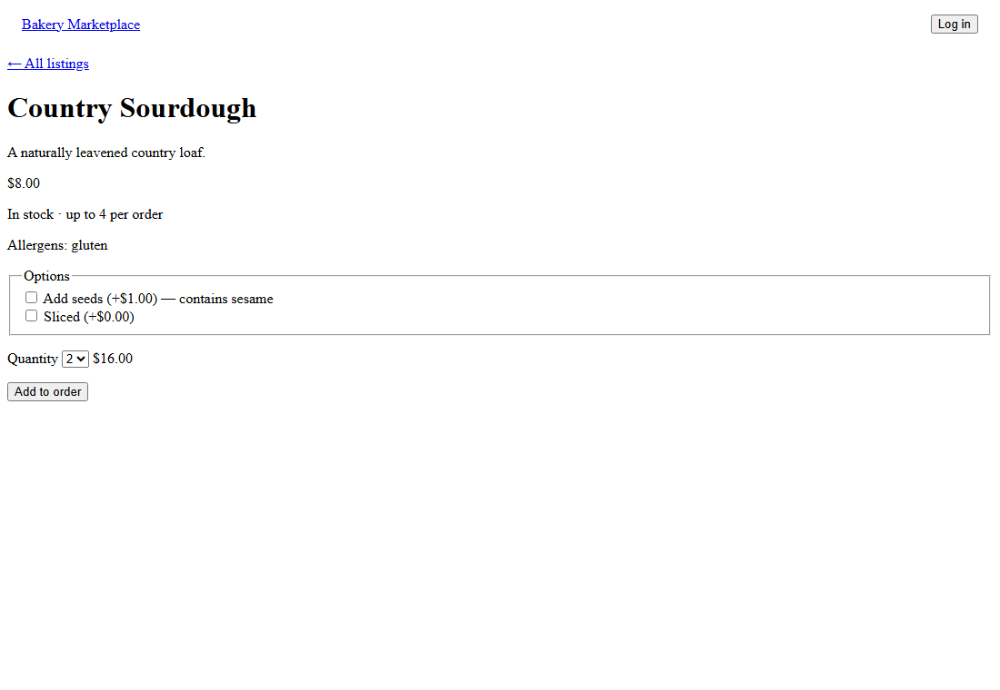
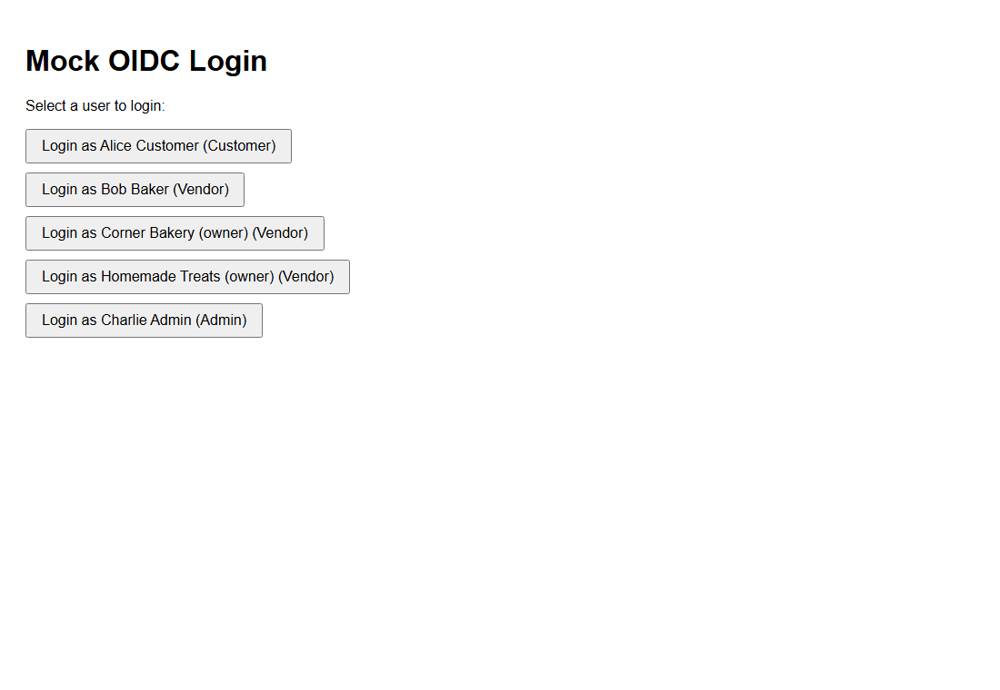
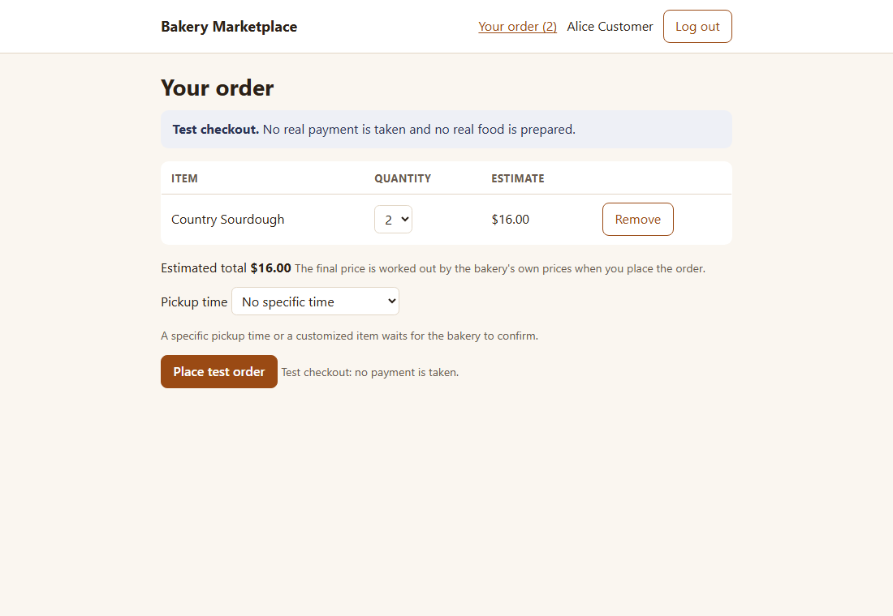
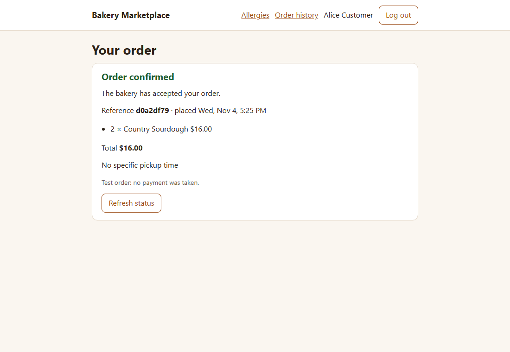
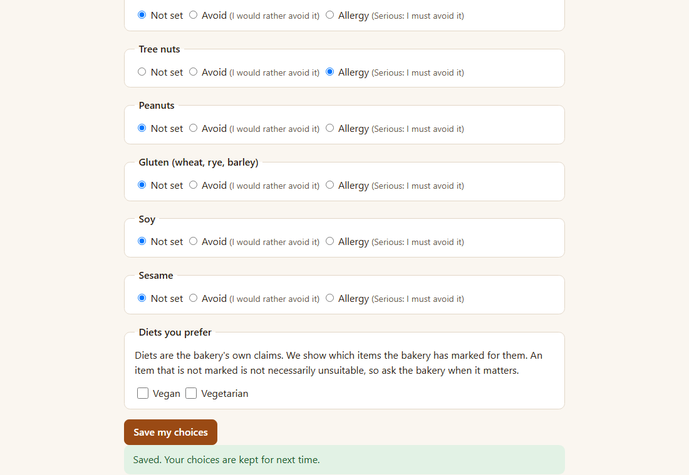
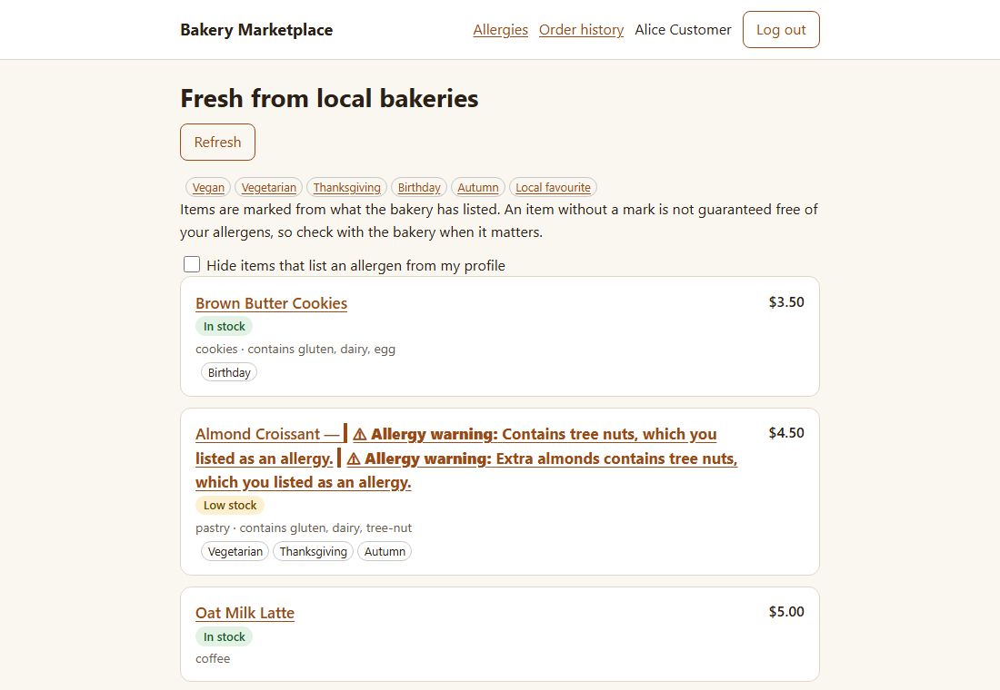
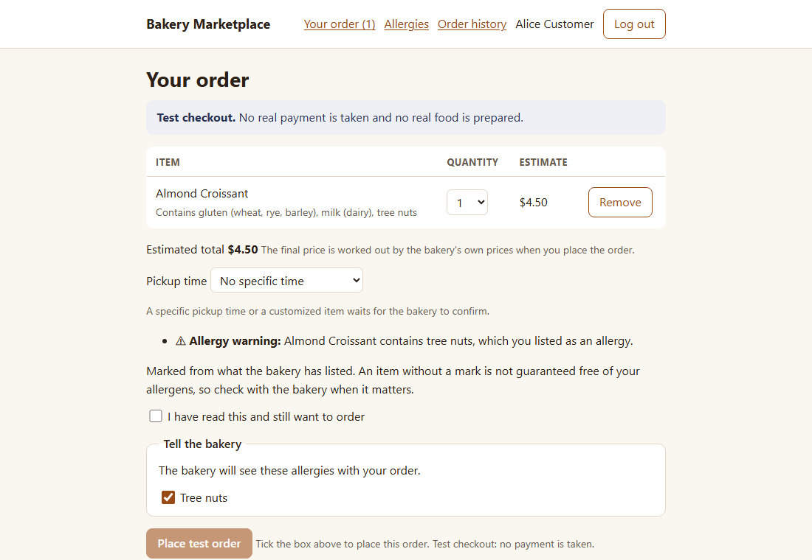
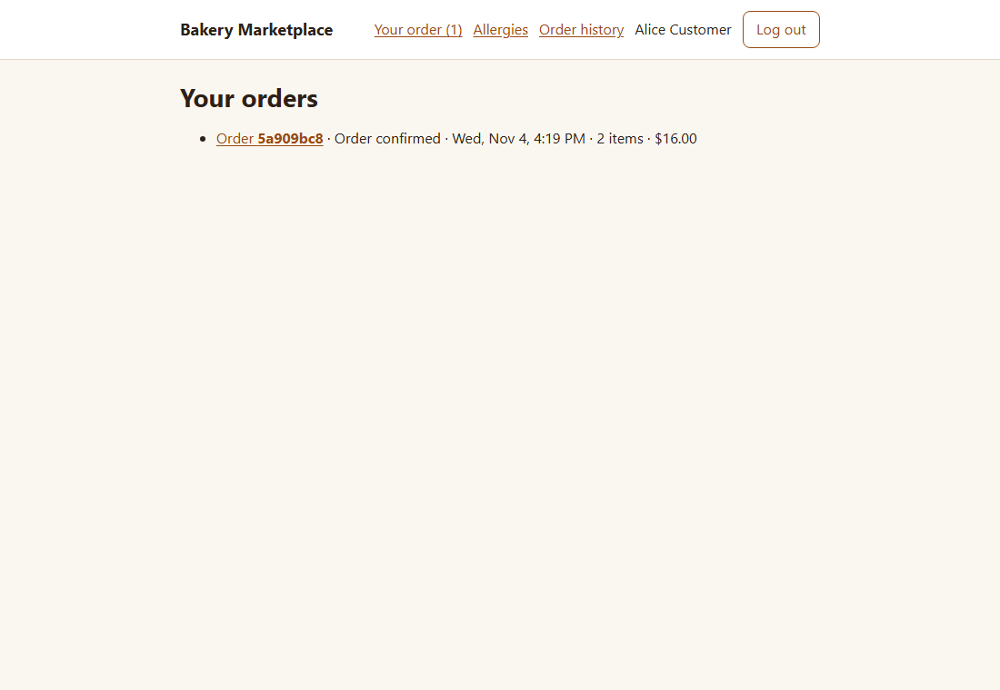

# Demo: run slice 1 and show it

> **Status:** Current · rewritten 2026-11-04 after a run on Windows 11 with Docker Desktop: `scripts/dev/demo.mjs` started the stack and printed its guide, and `scripts/dev/capture-journey.mjs` (extended the same day) walked the journey below against it and took all nine screenshots; the first checkout took 2.7 s. The demo was stopped by killing its process and running `docker compose down` by hand, so the Enter and Ctrl+C path was not exercised this time. Start-up time was not re-measured (the 87 s of 2026-10-30 predates the session Redis and the personalization pages). Nothing is deployed and the payment is a test stub. A run on a machine with nothing cached, and a person following this page without help, have not been done (`WI-DEMO-001`).

**To see it without running anything:** the [demo film](demo/demo-film.mp4) (104 seconds): a web customer with a tree-nut allergy, a phone customer with dairy and tree-nut allergies and the bakery's live queue on one screen, with other customers ordering at the same time. It is a local run with test payments (how it was made: [demo film](demo-film.md)).

What it shows: a customer browses listings with stock, allergens and tags, chooses a quantity or an option, logs in through the local mock identity issuer, saves an allergen profile, sees allergy warnings on browse and a warning with a confirmation at checkout, places a test order, watches its status and finds it in the order history. Behind that: a Next.js app, a GraphQL BFF, a catalog service and an ordering service, with Cosmos, two Redis instances (domain events; sessions) and the issuer in Docker. How the pieces work is in [the request path](../architecture/request-path.md); the commands for running by hand are in [local development](local-dev.md#run-slice-1); every script is indexed in [scripts and commands](scripts.md). The Android app has its own demo, `node scripts/dev/mobile-demo.mjs` (see the app's [README](../../apps/mobile-customer/README.md)).

## Start

You need Docker (running), the .NET 10 SDK, Node 24 or later and git, and `npm ci` done once in `apps/web-customer`, `services/graphql-bff`, `packages/web-session` and `packages/customer-core`. From the repository root:

```
node scripts/dev/demo.mjs
```

It creates the local secrets (a git-ignored `.env`), starts the four Docker containers (Redis for events, Redis for sessions, the Cosmos emulator, the mock issuer), seeds the catalog, starts the three host services (catalog, ordering, BFF), builds and starts the web app, warms the stack and prints a guide. The first run also builds the .NET projects. Ports 3000, 4100, 5200 and 5300 must be free; the script refuses to start otherwise. Press Enter or Ctrl+C to stop; everything is torn down and the data is lost (`--keep` leaves Docker running).

## Where things run



The BFF forwards the caller's token unchanged and every service validates it itself against the issuer. `scripts/dev/demo.mjs` starts everything above; `docker compose up -d` alone starts only the three always-on containers (`--profile with-redis` adds the session Redis); `scripts/ci/skeleton-smoke.mjs` starts the same stack and runs the browser journeys instead of waiting.

## Checklist: show the journey

| Step | Do | Expect |
|---|---|---|
| 1. Start | `node scripts/dev/demo.mjs`, wait for the guide | `http://localhost:3000`, the mock users, the steps |
| 2. Browse | Open the URL | Seven listings with price, stock, allergens and tags: "Blueberry Oat Muffin" is sold out, "Almond Croissant" is low stock. The tag chips filter the list |
| 3. Choose | Open "Country Sourdough"; pick quantity 2 (or the sesame option) | The estimate updates; options show their allergens ("contains sesame") |
| 4. Add | Add to order, then open "Your order" | The cart shows the line with what it contains; checkout asks you to log in |
| 5. Log in | Log in | The mock issuer's own page; choose "Login as Alice Customer (Customer)". Her name then shows in the header |
| 6. Order | Choose a pickup time if you like, then "Place test order" | The first checkout is slower than later ones (2.7 s on the 2026-11-04 run, 7.0 s on 2026-10-30) |
| 7. Status | Read the order page | A plain order is "Order confirmed" by itself; an order with an option or a pickup time waits for the bakery. "Test order: no payment was taken." |
| 8. Allergies | Open "Allergies", mark Tree nuts as "Allergy", save. Go back to the listings | "Almond Croissant" now carries allergy warnings, for the item and for its "Extra almonds" option. A tick box can hide items that list an allergen of your profile |
| 9. Warn | Add "Almond Croissant" to the order, open "Your order" | An allergy warning names the line and the allergen; "Place test order" stays off until "I have read this and still want to order" is ticked; "Tell the bakery" lists Tree nuts (ticked) so the bakery sees it with the order |
| 10. History | Open "Order history" | The order from step 6 with its status and total |
| 11. Stop | Enter or Ctrl+C | Processes stopped, containers removed |

**The vendor's half (added 2026-11-07).** `demo.mjs` now also starts the vendor's live queue screen (`apps/web-queue-display`, port 3100; `--customer-only` skips it). Open it, log in as "Corner Bakery (owner) (Vendor)" on the issuer's page, and an order placed in the customer app appears at once (push, with polling as the fallback). An order with an option or a pickup time waits there for "Accept" (or "Decline"); then "Start preparing", "Mark ready" and "Handed over" move it along, and each step shows on the customer's order page by itself within about five seconds (the page polls while the order can still change; "Refresh status" reads at once; a tab that is hidden asks nothing). The Android demo (`mobile-demo.mjs`) starts the same vendor screen, so an order from the phone can be worked there and the phone's order page follows. An accepted order also has a "Cancel" button (it asks first); the customer has a "Cancel order" button on their order page while it is placed or confirmed (it asks first too), and a cancel gives the held stock back. The 2026-11-07 check of this change started both screens (customer 200, vendor 200) and tore everything down cleanly; a person did not click through the vendor steps by hand (the same steps are in the real-stack journey `vendor-actions.spec.ts`, which passes in `skeleton-smoke.mjs`).

What not to expect: there is no vendor screen for listings, stock or onboarding; the admin app is empty; there is no free-text search and no real payment; and the look is one small stylesheet (light and dark by system setting), not a designed brand. A reload keeps the login (the session lives on the server, ADR-0019), and the allergen profile you save stays until the stack is torn down.

## Screenshots

Taken by `node scripts/dev/capture-journey.mjs` against the running demo (2026-11-04; the script places one order and saves an allergy profile for Alice, nothing more).

| Browse | Listing |
|---|---|
|  |  |

| Login | Checkout |
|---|---|
|  |  |



| Allergen profile | Warnings on browse |
|---|---|
|  |  |

| Warning and confirmation at checkout | Order history |
|---|---|
|  |  |

## If something goes wrong

| Symptom | Likely cause and what to do |
|---|---|
| `port <n> (...) is already in use` | Something else is on 3000, 4100, 5200 or 5300; stop it |
| Stuck at the environment check | Docker is not running or is still pulling images; `docker compose ps` and `node scripts/dev/check-env.mjs --wait 180` |
| `<name> did not become healthy` | Read `artifacts/demo/<name>.log` (catalog, ordering, bff, web) |
| The listing page shows no listings | The seed did not run or the catalog is down; stop and start again (data is not kept) |
| The first checkout seems stuck | It is slower the first time (service token, first priced checkout; 2.7 to 7 s measured); wait |

## Measured and not measured

- **2026-11-04, two runs:** `demo.mjs` started the stack and printed its guide (the warm-up took 0.1 s, everything was cached), and `capture-journey.mjs` ran all nine steps without failing: login, an order (first checkout 2.7 s, status "Order confirmed"), saving the tree-nut allergy, the warnings on browse, the warning and the unticked confirmation at checkout (the button was not clicked), and the order history. Later the same day, after the empty green box under the "hide items" tick box on the browse page was fixed (register 149), the demo was started again and the same script retook all nine screenshots (first checkout 2.5 s). The screenshots above are from the second run. The agent that took them looked at the browse screenshot (the box is gone); from the first run it had looked at the warnings on browse and at the checkout warning, and it has not looked at the other screenshots. Both times the demo was stopped by killing its process and running `docker compose down`, not by Enter.
- **2026-10-30:** the script was run once from start to stop, with `--stop-after 20`: 87 s, exit 0, no containers left. The first checkout then took 7.0 s even after the warm-up, which does not cover the first priced checkout (register item 98). Both numbers are one run each on one machine.
- Docker images, NuGet packages and npm packages were already cached. A first run on a machine with nothing cached will take longer; it has not been timed (`WI-DEMO-001`).
- Not run: the acknowledgement being ticked and the order with the allergen being placed in this demo (the browser suites and the real-stack journeys cover it), a reload keeping the login (ADR-0019 and its tests, not re-run here), the vendor's queue screen.
- Not done: a person who did not write this following the page, and timing how long a visitor takes to find the evidence from the README (`WI-DEMO-001`, rows G-H07 and G-H09).
