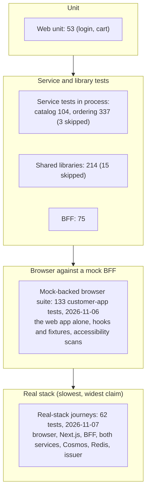

# Test strategy

> **Status:** Current · written 2026-10-30 from the test projects, the pipeline and the evidence records (`WI-QA-001`). It says what each layer proves, what it does not, and what is deliberately not tested. The commands are in [`quality-gates.md`](quality-gates.md); the measured baseline is [`docs/evidence/baseline-2026-10-30.md`](../evidence/baseline-2026-10-30.md); how to write and review a test is in the [Playwright guide](playwright-guide.md) and the [test-review checklist](test-review-checklist.md).

> **Proposed 2026-11-02 (register item 130):** [`verification-policy.md`](verification-policy.md) says which checks each change carries and which run as scheduled checkpoints. The counts in the table below were typed by hand on 2026-10-30 and are stale (for example the BFF has 107 tests, ordering 432, the queue display 22 unit and 32 browser tests); `CLAUDE.md` has the later figures, and a script should print them (`WI-QA-002`).

## Principles

1. **A test is evidence only if it can fail.** A passing test proves nothing until breaking the code it names makes it fail. The mutation sample of 2026-10-30 killed 9 of 10 and found one that tested the framework, not the project (register item 85).
2. **Prove it on a clean Linux agent, not only on the development machine.** Seven of the ten test failures recorded between 2026-10-26 and 2026-10-29 passed locally and failed only on a clean agent ([`test-reliability/findings.md`](../evidence/test-reliability/findings.md)).
3. **Real dependencies where the claim is about them.** An adapter test that falls back to a fake when the real service is absent proves less than it appears to (register items 31 and 35); the pipeline asserts that the Redis tests reached Redis.
4. **Report passed, failed, skipped and not-run separately.** A skip is never counted as a pass.
5. **Repeat to believe a fix.** One green run does not show a flake is gone; the mock-backed browser suite has been run 10 times (570 executions, 0 failures).

## The layers

| Layer | Where | Count (2026-10-30) | Proves | Does not prove | Runs in the pipeline |
|---|---|---|---|---|---|
| Web unit | `apps/web-customer/tests/unit` | 53 | The login library (PKCE, state) and the cart | Anything rendered | `web` |
| BFF | `services/graphql-bff/test` | 75 | Field mapping, paging, global ids, error mapping, trace propagation, token forwarding (and that the token is never logged or sent to the catalog), no-store responses | The services behind it (they are stubbed) | `bff` |
| Shared libraries | `tools/tests` (7 projects) | 214 passed, 15 skipped | The adapters (cache, data, eventing, secrets, auth) against their contract tests, with a chaos decorator where resilience matters | The Cosmos adapters against Cosmos: they fall back to fakes by default (item 31); 15 emulator-gated tests are skipped | `dotnet` (Redis real, Cosmos not) |
| Catalog service | `services/catalog-service/tests` | 104 | Listing rules, validation, stock, endpoints, hosted in process on in-memory backends | The Cosmos backend | `dotnet` |
| Ordering service | `services/ordering-service/tests` | 337 passed, 3 skipped | The order aggregate and lifecycle, checkout and idempotency, pickup windows, outbox and relay, actions, authorization | The Cosmos store (emulator-gated, not run in CI) | `dotnet` |
| Mock-backed browser | `apps/web-customer/tests/e2e` | 133 on 2026-11-06 (62 on 2026-10-30, then the sessions, personalization and mobile work) | The web app in a real browser: server rendering, hydration, login against a stubbed issuer, cart, checkout, order page, stock, error states, no console errors; the four page types have no automatically detectable WCAG 2.0/2.1 A and AA violation, in the light theme and (listings) the dark one | The real BFF, services or issuer; keyboard use, focus order, screen-reader wording | `web` |
| Real-stack journeys | `apps/web-customer/tests/skeleton` | 62 on 2026-11-07 (21 on 2026-10-30) | The whole slice: login through the real mock issuer, browse, order, confirmation, a declined payment (an invalid-token method), stock limits, payment methods, token validation by each service | A deployed environment; load; browsers other than Chromium | `skeleton` |

Also run, not in the pipeline: SSR isolation (`npm run test:isolation`: 200 concurrent requests, two fixtures, no leakage), and mutation checks by hand (a sample of 10, about ninety over slice 1).

## Deliberately not tested

- **Load and capacity at scale.** Load, soak, generated-input and dynamic-scan runs exist for the local stack (`WI-SEC-005`, 2026-11-02 to 11-03: a 66-minute soak with five live screens and a restart, generated-input tests, two OWASP ZAP scans; [`nfrs.md`](../architecture/nfrs.md) section 8). They are one machine and a light load: no several-replica run, no production-sized database, no proof of a target at scale (`WI-QA-002`). Fuzzing guided by coverage is not done.
- **Anything deployed.** Nothing is deployed, so there are no post-deploy checks.
- **Other browsers and real devices.** Browsers: Chromium by default; Firefox, WebKit and phone-profile projects have been run against the mock-backed suites (second full run 2026-11-06: customer app 663 of 665, queue display 296 of 300, `docs/evidence/cross-browser/`), not the real-stack journeys, and a clean full repeat is a scheduled checkpoint (`verification-policy.md` section 4). Mobile: the Android customer app has fifteen Maestro flows on an emulator, run locally with `node scripts/dev/mobile-flows.mjs` (`WI-MOB-001` to `WI-MOB-003`, `docs/evidence/WI-MOB-*`), and unit tests of its session and API logic that run in the pipeline's `mobile` job; no iOS, no real device, the flows are not in the pipeline (register 148).
- **Payment.** The processor is a stub; no provider is exercised.
- **Real identity.** The issuer is a local mock; the real provider's behaviour is not tested.
- **The Cosmos adapters against Cosmos, in CI.** Emulator-gated tests exist and are run by hand.
- **Accessibility beyond axe-core.** The smoke (`tests/e2e/accessibility.spec.ts`) checks what a tool can decide; keyboard operation, focus order, zoom and screen-reader wording are not tested.
- **Documentation tests.** Only the status check, the link check and a diagram syntax check by hand (`quality-gates.md`).

## Gates as pass or fail

A change is ready to push when these pass locally, and ready to merge when the pipeline's jobs are green. The pipeline is a soft gate: a reviewer reads the checks (ADR-0015).

| Gate | Pass means | Command |
|---|---|---|
| Format, lint, typecheck | No finding | `node scripts/ci/node-gates.mjs` |
| .NET build, format, tests | Zero failures; skips named | `node scripts/ci/linux-check.mjs` |
| Redis really reached | At least 50 commands counted | the `dotnet` job |
| Documentation | Status check passes, no broken link | in `node-gates.mjs` and the `docs` job |
| Secrets | No finding | `node scripts/ci/secret-scan.mjs` |
| Browser suites | Zero failures, no retries | `npm run test:e2e`, `node scripts/ci/skeleton-smoke.mjs` |

## Known weaknesses

The Cosmos adapter tests pass without Cosmos (31, 35); one JWT test exercises the framework (85); one failure shape (a test that passes here and fails on a clean agent) needs the Linux run to catch it; flake rates are measured by hand, not trended (`WI-QA-002`); there is no coverage measurement.
